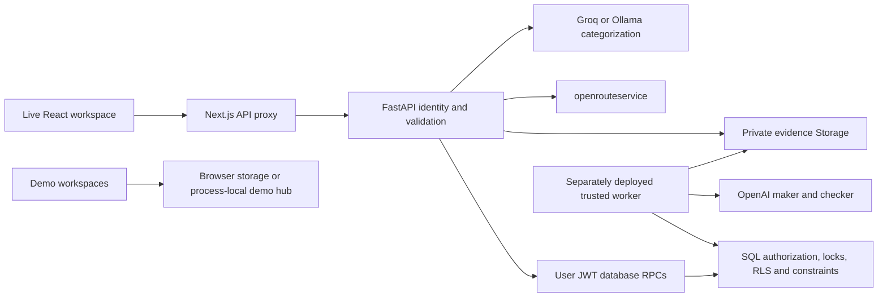

# ParcelCare Business Rules and Workflows

Approved SME flow correction: **Warehouse common stock → ordering SME**. External supplier replenishment is separate and out of scope. New shared-stock orders use saved SME delivery profiles and immutable per-order address snapshots. Legacy SME-owned stock remains isolated; this does not establish hosted deployment. See [implementation and rollout](../docs/SME-SHARED-STOCK.md).

Analysis date: 23 October 2026 (Asia/Yangon). Scope: the local workspace at `D:/slh/proj/parcelcare`, including its current files. This is a description of implementation, not an approved business policy or a deployed-system certification.

Subsequent outbound update: see [Outbound workflow](../docs/OUTBOUND-WORKFLOW.md) and migration `20261023000300_be1_outbound_returns.sql`. Direct third-party handovers now debit stock once, warehouse users can create outbound shipments and cancel external deliveries, and evidenced physical returns can restore good/quarantined stock after cancellation. The R-01 and WF-04 accounting observations below describe the earlier implementation; historical unposted handovers still require reconciliation. Direct creation still does not reserve stock, and hosted deployment is not established by these local changes.

## 1. Reading guide and business overview

Business readers should start with sections 1–3 and 5. Developers should also read the rule register, implementation boundaries, and inventories. QA should use section 7 together with the stable rule IDs. References are relative to the project root unless a Markdown link says otherwise.

Evidence labels used throughout:

- **C — Code-confirmed:** observed in executable source or SQL migrations. This does not establish deployment or real-world truth.
- **T — Test-confirmed:** supported by an existing test run during this analysis. API tests generally replace providers/database boundaries; isolated SQL tests use PGlite and Auth/Storage stand-ins.
- **I — Inferred:** a consequence of the inspected implementation that needs targeted reproduction or business confirmation.
- **U — Unresolved:** missing operational evidence or an unanswered business decision.

The rule register describes C evidence unless explicitly marked otherwise. Section 7 identifies the test evidence separately; a passing suite does not prove every statement or risk below.

### 1.1 What the system does

ParcelCare holds products for SMEs in warehouses, records inbound receiving, prepares outbound shipments, coordinates delivery, and investigates exceptions. It distinguishes a recorded observation, an SME decision, a physical verification, and completed delivery. These are separate records and do not automatically substitute for one another.

For example, expected 100, received 90, and damaged 5 means 10 missing, 85 good units added to available stock, and 5 units added to quarantine. Final receiving creates separate shortage and damage cases. An SME accepting the partial receipt records intent; staff still need the required verified outcomes before closing the operational case.

Two outbound modes exist. In-house delivery uses an assigned rider, pickup, dispatch, consented location sharing, proof, and SME receipt confirmation. Third-party delivery uses an evidenced carrier handover and staff-recorded carrier updates; ParcelCare does not provide the external carrier's device GPS.

### 1.2 Important distinctions

| Concept | What it establishes | What still needs separate evidence/action |
|---|---|---|
| Evidence reservation | Metadata and a private upload path | Successful file upload and verification of its contents |
| Uploaded object | A file exists in Storage | Whether its contents prove a count, custody event, or delivery |
| SME decision | An authorized SME chose an offered option | Capacity, stock correction, physical completion, or case closure |
| Arrival | Rider confirmed proximity to the saved destination using qualifying GPS | Delivery proof and SME receipt confirmation |
| AI checker approval | A separate model call passed the proposal checks | Policy opt-in and server-side execution gates |
| Case closure | Authorized staff recorded required facts and a resolution | Independent truth of those physical assertions |
| Browser demo success | The demo state changed | Any change to the live database |

### 1.3 Architecture and enforcement

The frontend is Next.js 16.4.2/React; API composition is `api/app/core/application.py:create_app`. Most domain HTTP handlers call the user-scoped RPC allowlist in `api/app/core/database.py:SupabaseUserDatabase.rpc`. The supplementary profile/evidence handlers use the separate user-JWT HTTP adapter in `api/app/core/user_access.py`. Neither path gives HTTP users the worker credential.

SQL security-definer commands explicitly authorize resources because their table access is privileged. RLS protects direct user reads, and ordinary authenticated users receive specific commands rather than general table mutation rights. Composite tenant foreign keys provide an additional boundary. UI role checks are convenience controls, not the final authority.

## 2. Runtime modes, roles, and interfaces

### 2.1 Modes must remain distinguishable

| Mode | Source / entry point | Persistence and business meaning |
|---|---|---|
| Live workspace | `src/features/auth/session.tsx:SessionProvider`; `/warehouse`, `/sme`, rider/courier pages | Supabase session, verified `/api/me`, same-origin API. Missing service/auth configuration is unavailable, not demo success. |
| Explicit React demo | `SessionProvider` with `demo=true`; `src/shared/api/mock.ts`, `warehouse-mock.ts`, `courier-mock.ts`, `sme-tracking-mock.ts` | Fictitious datasets and browser/session state. Separate adapters differ in supported commands. |
| Preserved manager/report demo | `src/features/workspace/runtime.js`, `reports/reports.js`, `exceptions/maker-checker.js`, policy and priority scripts | Browser-local data and simulated role switching. Its manager role and report statuses are not database membership roles/statuses. |
| Office prototype | `src/features/office/OfficeDashboard.tsx`, `model.ts`; `/office` | Fictitious cases/activity under localStorage key `parcelcare-office-demo-v1`. No production case mutation should be inferred. |
| Shared tracking demo | `src/app/api/demo/tracking/route.ts`, `src/shared/api/demo-sync.ts:createDemoHub` | Public fictitious process-local state, revision checked, reset on server restart; separate server instances can diverge. |
| Trusted worker | `api/app/worker.py:main` | Requires server-only worker key; analysis and maintenance are separate from interactive HTTP. Existence of deployment YAML does not prove a running worker. |

The shared demo accepts `advance`, `arrive`, `receive`, `reset`, and `settings`. Identical keys replay; changed requests conflict; stale revisions conflict. Its last 100 command signatures are retained in memory. It has no live RBAC and never accesses shipment/GPS tables. An Origin mismatch is rejected when Origin is supplied; that is not user authentication.

### 2.2 Authority matrix

| Actor | Authorized business capability | Limits |
|---|---|---|
| `owner` | Warehouse staff capabilities; edit warehouse SLA policies; eligible SLA manager | Scoped to active warehouse membership; not a global administrator |
| `staff` | Warehouse inventory, shipments, receiving/corrections, assignments, case actions/reviews/verifications/closure | Cannot decide as an SME or edit owner-only SLA policies |
| `sme` | Own-tenant inventory/shipment/case views, reports/information, offered decisions, receipt confirmation, notification read state | Warehouse operations endpoints are staff-only; cannot self-grant access or adjust stock |
| `rider` | Assigned shipment/evidence access, own acceptance/pickup, proof, tracking and narrow issue reporting | No general warehouse inventory or case-management access |
| Worker/service role | Narrow registered analysis/maintenance RPCs in the Python wrapper | Credential is privileged beyond a browser user; application allowlist is not a substitute for protecting that credential |
| `parcelcare_worker` SQL role | Leased outbox claim/ack, purge capability, SLA scheduler capability | NOLOGIN/NOINHERIT; distinct from the service-key Python worker |

Multiple memberships are possible. `operations/service.py:scope` selects a warehouse automatically only when exactly one staff-authorized warehouse exists. Frontend `roles.ts:workspacePath` prefers staff, then SME, then rider when choosing a landing path; that preference does not remove other memberships.

### 2.3 Public contracts

No interface is changed by this analysis. Active HTTP routes are inventoried in Appendix B. Domain payloads use `api/app/contracts.py`, feature models, `contracts/openapi.json`, and generated TypeScript. Most DTOs forbid extra fields; important stock quantities and versions are strict integers. Generic `dict`/`list[dict]` responses provide weaker HTTP response validation than typed warehouse DTOs.

For versioned commands preserve the original UUID `Idempotency-Key`, payload, expected version, and source/policy version where required. Network loss or 503 can mean the outcome is unconfirmed. Do not assume failure and submit a fresh stock-changing operation. Not every POST implements a command ledger: evidence reservations, tracking lifecycle, notification state, arrival, and routing have their own replay behavior.

The proxy forwards only authorization, content type, idempotency and correlation headers; it adds no privileged credential. It requires a configured safe API origin, validates paths, limits request bodies to 10 MiB, refuses redirects/non-JSON upstream responses, and uses no-store. The live transport does not automatically retry mutations or fall back to mock data. Sources: `src/app/api/[...path]/route.ts:forward`, `src/shared/api/transport.ts:createLiveTransport`, `validateRequest`.

## 3. Business rule register

### 3.1 Identity, access, and account settings

| ID | Condition → behavior | Enforcement and evidence source | Database objects |
|---|---|---|---|
| BR-AUTH-001 | Missing/invalid bearer session → reject; auth outage/configuration missing → unavailable; no active membership → forbidden | `core/auth.py:current_identity`; `core/supabase_auth.py:SupabaseAuthenticator.verify`; supplementary `core/user_access.py:identity` (C,T) | `memberships`, `profiles` |
| BR-AUTH-002 | Claimed role/tenant/actor from client input → does not grant permission; use verified Auth user and active DB membership | Same authenticators; `20261021000100_be1_identity.sql:private.is_staff`, `private.is_sme`, `private.can_read_tenant` (C,T) | `memberships`; tenant foreign keys |
| BR-AUTH-003 | Staff → own warehouse; SME → own SME; rider → assigned shipment; internal analyses/jobs/audit/stock movements → staff | `20261021000400_be1_security.sql` read policies and authorization helpers (C,T) | Tables with RLS; raw `rider_locations` SELECT revoked |
| BR-AUTH-004 | Direct table mutation by ordinary users → denied; use reviewed RPCs; legacy receipt/approval command execution retired for authenticated users | Security migration plus final revocations in `...00800_be1_warehouse_operations.sql` and `...00900_be2_case_workflows.sql` (C,T) | `receive_shipment`, `decide_approval` retained internally |
| BR-AUTH-005 | Session identity/context changes → recheck memberships and discard stale identity responses; sign-out attempts cleanup and local-scope session revocation | `src/features/auth/session.tsx:SessionProvider`, `src/shared/session/cleanup.ts:cleanupSession` (C) | Supabase Auth; sessionStorage |
| BR-ACCOUNT-001 | Account view → show ID and memberships read-only; manager prototype → demo account | `src/shared/layout/my-account.tsx:MyAccount`, `ManagerAccount`, `AccountInfo` (C) | No profile/membership write endpoint here |
| BR-ACCOUNT-002 | Language selection → English/Myanmar preference in browser storage; no permission change | `src/shared/layout/account-menu.tsx:LanguageMenu`; `src/shared/i18n/runtime.js` (C) | Browser preference rather than account profile mutation |

An assignment helper considers an uncancelled assignment even if completed; current assignment lists and write commands impose additional completion/status gates. Do not summarize all rider read permissions as “active unfinished assignments only”; see R-06.

### 3.2 Warehouse operations and stock

| ID | Condition → behavior | Enforcement and evidence source | Database objects |
|---|---|---|---|
| BR-OPS-001 | Create shipment → require authorized warehouse/SME and same-tenant products, positive expected quantities, 1–100 lines and no duplicate product IDs; inbound has null mode, outbound has mode | `operations/models.py:CreateShipment`; `public.ops_command` in `...00800...`; constraints in `...00200...` (C,T) | `shipments`, `shipment_items`, `products`; warehouse reference unique |
| BR-OPS-002 | Create → inbound starts `expected`, outbound starts `ready`; no stock reservation/debit at creation | `public.ops_command`, kind `create` (C,T) | `shipments`, `shipment_items` |
| BR-REC-001 | Receive → staff only, current shipment version, inbound receivable state, no earlier final receipt; quantities are increments | `public.ops_command` receipt wrapper; internal `public.receive_shipment` in `...00500_be1_commands.sql` (C,T) | `receipts`, `shipment_items`, command ledger |
| BR-REC-002 | Received/damaged input → nonnegative integer; damage ≤ received; cumulative received ≤ expected; foreign/duplicate lines reject atomically | `contracts.py:ReceiptLine`, `ReceiptRequest`; receipt SQL (C,T) | Line constraints; locked shipment/products |
| BR-REC-003 | Receive R units with D damaged → available += R−D, quarantine += D, movement records previous/new balances | `public.receive_shipment`; version increments in `public.ops_command` (C,T) | `products`, `stock_movements` |
| BR-REC-004 | Nonfinal → `partially_received`; final clean → `received`; final shortage/damage → `received_with_discrepancies`; shortage case only at finalization, damage case immediately | Receipt SQL (C,T) | `exception_cases`, `case_events`, typed receipt outbox events |
| BR-REC-005 | Browser receipt with damage or final shortage → require note and selected uploaded evidence; final submit also requires acknowledgment | `src/features/warehouse/validation.ts:receiptRequest`; `receipt.tsx:ReceiptForm` (C,T for validation) | UI-only mandatory-evidence rule; backend accepts empty note/evidence, see R-14 |
| BR-STOCK-001 | Correction → staff, current product version, nonzero deltas, note and uploaded same-tenant evidence; reject negative resulting balances | `operations/models.py:StockCorrection`; `public.ops_command`, kind `correction` (C,T) | `products`, `stock_movements`, `evidence`, `storage.objects` |
| BR-DISPATCH-001 | In-house outbound → record `picked`, then `packed`, then `dispatched`; dispatch needs active rider/membership, accepted assignment and pickup | `private.ops_allowed`, `public.ops_command`, kind `event` (C,T) | `shipment_events`, `delivery_assignments`, `riders` |
| BR-DISPATCH-002 | Dispatch → lock products, require enough available stock, debit all lines atomically and record movements; invalid/insufficient operation rolls back | `public.ops_command` (C,T) | `products`, `stock_movements`, shipment version/status |
| BR-OPS-003 | Verified event time → cannot precede shipment creation/latest recorded verification or be in the future | `public.ops_command`, kind `event` (C,T) | `shipment_events.details` |
| BR-OPS-004 | Lists → limit 1–100, UUID keyset cursor; case issue/priority/mode/state/owner filters apply before pagination | `operations/router.py`; final `public.ops_read` wrapper in `20261022001000_be1_workspace_features.sql` (C,T) | Authorized warehouse collections |

Receiving finalization closes that receiving operation even when units remain missing. A subsequent remainder needs a separately defined follow-up shipment/workflow; the original final receipt cannot be posted again to add it. Neither a case note nor AI recommendation adjusts inventory.

### 3.3 Delivery, courier, tracking, and arrival

The final delivery implementation is `20261022120000_be1_tracking_arrival_settings.sql:public.delivery_command`, superseding `20261021001100_be1_delivery_workflows.sql`. The final version restricts receipt confirmation to SME membership and adds arrival gating.

| ID | Condition → behavior | Enforcement / source | Database objects |
|---|---|---|---|
| BR-DEL-001 | Assign/reassign → staff only; in-house outbound, eligible shipment state, active same-warehouse rider/membership; cancel old current assignment and create new one | Final `public.delivery_command`; `...00700_be1_invariants.sql` (C,T) | `delivery_assignments`; unique active assignment; mode guard |
| BR-DEL-002 | Accept/pickup → assigned rider's own identity; pickup additionally requires acceptance and packed event | Final `public.delivery_command` branches `accept`, `pickup` (C,T) | Assignment timestamps; shipment `assigned` → `picked_up` |
| BR-DEL-003 | Submit proof → assigned access/staff gate, active picked-up assignment, `in_transit`, recipient name and uploaded shipment evidence | Final `public.delivery_command`, `proof` (C,T) | `delivery_proofs`; submission does not mark delivered |
| BR-DEL-004 | Confirm receipt → own SME, current version, unconfirmed proof from another actor, file exists and shipment `in_transit`; in-house also requires arrival for current assignment | Final `public.delivery_command`, `confirm` (C; earlier proof/confirmation path T, final arrival gate inspected) | Proof confirmation; shipment `delivered`; assignment complete; tracking termination triggers |
| BR-DEL-005 | Third-party handover → staff, ready/delayed external outbound, evidence, carrier, waybill, positive package count, condition and valid acceptance time | Final `public.delivery_command`, `handover`; API `DeliveryCommand.safe_link` (C,T) | `handover_records`; status `handed_over`; HTTPS tracking link |
| BR-DEL-006 | Carrier update → staff, prior handover and uploaded evidence; one of handed_over/delayed/failed/delivered | Final `public.delivery_command`, `courier` (C,T) | Shipment status and last verified timestamp; no carrier webhook inferred |
| BR-DEL-007 | Proposed retry → not a booking; capacity command needs decided `propose_retry` approval on same shipment/open case, current assignment and future schedule | Final `public.delivery_command`, `capacity` (C) | `delivery_capacity`, unique approval; no automatic reassignment/redispatch |
| BR-RIDER-001 | Rider reports issue → own current accepted in-house outbound assignment; allowed types: recipient_unavailable, delivery_failed, transit_damage, courier_delay | `deliveries/router.py:report_issue`; `20261022006100_be1_rider_exception_reporting.sql:public.rider_report` (C,T) | Case matched/created, timeline/audit/outbox; delivery status unchanged |
| BR-GPS-001 | Start sharing → assigned active rider/membership, accepted pickup, explicit true consent, in-house nonterminal delivery and GPS enabled | Final `public.start_tracking`; UI `src/shared/api/location-start.ts:startWithFirstPosition` and tracking share component (C,T) | Reuse active session or create one; consent timestamp |
| BR-GPS-002 | Publish position → current authorized session/rider; valid coordinate/accuracy; recorded no more than 30 seconds future or 5 minutes old; replay same latest packet returns ID | Final `public.record_location`; table checks (C,T) | `tracking_sessions`, `rider_locations` |
| BR-GPS-003 | New position → strictly ordered; at least 10 seconds between server receipts; conflicting same-time or old packet rejected | Final `public.record_location` (C,T) | Session row lock; unique session/time |
| BR-GPS-004 | Read location → reauthorize active session and return at most latest point within 24-hour receipt window; no point = unavailable, older than 60 seconds = stale; audit access without coordinates | `...00600_be1_tracking.sql:public.get_live_location`; `private.can_read_tracking` in security migration (C,T) | Raw coordinate table not user-readable |
| BR-GPS-005 | Stop, delivery/cancellation, assignment completion/cancellation or disabling live GPS → terminate applicable sessions; do not accept further packets | `public.stop_tracking`, terminal triggers, final `public.tracking_settings` (C,T for stop/terminal behavior) | `tracking_sessions` |
| BR-GPS-006 | Realtime notification → coordinate-free invalidation on private topic; client must reauthorize live read; client publish denied for tracking topic | `20261022003000_be1_private_tracking.sql:public.can_receive_tracking_topic`, `private.broadcast_location_change` (C,T with stand-ins) | Conditional `realtime.messages` policies; native availability U |
| BR-ROUTE-001 | Calculate route → accepted own rider assignment, active outbound in-house shipment, explicit consent, live GPS setting and server routing key | `deliveries/router.py:route`; `routing.py:calculate_route` (C,T) | Authorized delivery reads; external provider call outside DB transaction |
| BR-ROUTE-002 | No-route/snap error 2009/2010 → try car, bicycle, walking in order; other errors do not trigger mode fallback; never invent straight-line route/traffic ETA | `calculate_route` (C,T) | Provider result normalized to lon/lat, distance m, duration ms |
| BR-ROUTE-003 | Share route → assigned rider, bounded valid geometry and timestamps, last/newer request wins; same key returns existing route; read expires after 24h and needs assignment/session access | Final `public.route_plan_write`; `public.route_plan_read`, `private.can_read_route_plan` in `20261022005000_be1_shared_route_plans.sql` (C,T) | `shipment_route_plans` |
| BR-ARRIVAL-001 | Confirm arrival → own assigned rider, in_transit, saved unexpired route/current assignment, active-session sample ≤60 seconds old, accuracy ≤100m, distance ≤100m to saved destination | Final migration `public.shipment_arrival`; UI `tracking/arrival.tsx:CourierArrival` (C) | `shipment_arrivals`, delivery.arrival event, audit; no delivered transition |
| BR-GPS-007 | Tracking settings → any active warehouse member may read; staff may change two booleans, defaults true/true; GPS off stops active sessions | Final `public.tracking_settings`; API set handler also `require_staff` (C) | `warehouse_tracking_settings`; demo setting is separate from process demo hub state |

### 3.4 Exceptions, investigation, SME decisions, and closure

Evidence rules shared by shipment, case and delivery workflows:

| ID | Condition → behavior | Enforcement / source | Objects |
|---|---|---|---|
| BR-EVID-001 | Reservation → authorized shipment, JPEG/PNG/PDF, 1 byte–10MiB; nonstaff cannot create internal-only evidence | `api/app/evidence.py:reserve`; `public.register_evidence`; evidence/bucket constraints (C,T) | Generated immutable object path and metadata |
| BR-EVID-002 | API upload → reserving actor, exact reserved MIME/size, bounded bytes and matching signature; no upsert | `api/app/evidence.py:upload`; Storage insert policy (C,T) | Direct Storage path has fewer API checks, R-09 |
| BR-EVID-003 | Download → metadata visibility plus Storage authorization/existence; signed URL lasts 60 seconds | `api/app/evidence.py:download`; supplementary GET download in deliveries router (C,T) | Private file content; URL is a temporary bearer capability |

| ID | Condition → behavior | Enforcement / source | Database objects |
|---|---|---|---|
| BR-CASE-001 | Staff/own SME reports known issue/stage with note and valid uploaded same-shipment evidence references → match open shipment+stage+type or create case | `exceptions/router.py:report`; `public.case_command_v1` in `...00900...`, called through final wrapper `...22002000...` (C,T) | `exception_cases`; partial unique open-case index |
| BR-CASE-002 | New ordinary case → normal priority, human handling, new status, responsibility UNDETERMINED unless another trusted writer explicitly changes it | `20261021000300_be2_cases.sql` defaults; report commands (C) | `exception_cases` |
| BR-CASE-003 | Staff action → current case and source versions, current SME policy version and allowed action; terminal case rejects | `public.case_command_v1`; `private.case_source` (C,T) | Version = case:shipment:latest policy version; workflow command ledger |
| BR-CASE-004 | Request decision → partial-receipt options accept_partial/await_remainder/reject; correction options accept/reject; other retry request options propose_retry/reject | `case_command_v1`, `action` branch (C,T) | `approvals`; case awaiting_sme_decision; notification |
| BR-CASE-005 | Stale decision request → reject; valid new request can cancel superseded pending approvals; exact already-decided same-actor decision/note/time can replay without new event | Final `public.case_command` wrapper in `20261022002000_be2_case_integration.sql` (C,T) | Approval requested case version + 1 relationship; workflow ledger |
| BR-CASE-006 | SME chooses offered option → own SME only/current policy; proposed retry time must be future; await/reject/retry → awaiting_information, acceptance → awaiting_verification | Wrapper and `case_command_v1` decision branch; internal `decide_approval` (C,T) | Approval choice and preferred time; no stock/capacity/delivery write |
| BR-CASE-007 | Verify fact → staff/current versions, allowed case fact other than sme_decision_recorded, at least one uploaded evidence ID; update fact record | `case_command_v1`, `verify` (C,T) | `case_verifications`, unique case/fact; first evidence ID stored as primary reference |
| BR-CASE-008 | Close → staff/current versions, nonblank note, all required facts, no pending approval or mandatory action; partial receipt needs accepted SME choice; await_remainder also needs remainder_completed | `case_command_v1`, `close`; `private.case_required` (C,T) | Case closed/verified fields; notification/audit/outbox |
| BR-CASE-009 | Owner review → staff assigns active same-warehouse staff/owner or clears assignment; responsibility review needs basis and uploaded evidence unless UNDETERMINED | `20261022004000_be2_case_reviews.sql:public.review_case` (C,T) | Case version, review event; responsibility event SME-visible, owner event internal |
| BR-CASE-010 | Information submission → authorized staff/own SME, current versions/nonterminal state; appends information event and increments case version | `case_command_v1`, `information` (C) | No automatic verification or closure |
| BR-NOTIFY-001 | Read/unread → authorized notification and per-user marker; list newest up to 100; repeated read is harmless | `public.tenant_feed`, `mark_notification_read`, `mark_notification_unread`; `exceptions/router.py` (C,T) | `notifications`, `notification_reads` |

Case workflow statuses are `new`, `investigating`, `processing`, `awaiting_information`, `awaiting_sme_decision`, `awaiting_courier_confirmation`, `awaiting_verification`, `resolved`, and `closed`. `update_workflow` permits only the five nonterminal targets listed in the action model. The general closure command writes `closed`; enum membership alone does not expose a `resolved` command.

Allowed policy actions are `save_summary`, `notify_sme`, `request_information`, `request_sme_decision`, `propose_correction`, `escalate`, and `update_workflow`. Escalate switches human handling/processing; saving summary edits summary; correction proposal creates an approval and a pending action rather than stock movement. See R-04 for its completion gap.

#### Required closure facts

Source of executable SQL requirements: `20261021000900_be2_case_workflows.sql:private.case_required`; corresponding policy definition: `contracts/policies/v1.json:closure_evidence` and Python `features/policies/service.py:require_verified_closure`.

| Case type | Required facts/outcomes |
|---|---|
| quantity_mismatch | count_verified, sme_decision_recorded, physical_handling_verified |
| damaged_goods | damage_assessed, quarantine_verified, disposition_verified, sme_decision_recorded |
| missing_stock | investigation_completed, stock_reconciliation_verified |
| wrong_pick | correction_verified, sme_receipt_confirmed |
| short_pick | remainder_delivered_verified, sme_receipt_confirmed |
| courier_delay | courier_update_verified, outcome_verified |
| delivery_failed | dispatch_or_return_verified, receiver_or_return_confirmation |
| recipient_unavailable | capacity_confirmed, verified_pod, receiver_confirmation |
| transit_damage | condition_evidence_verified, handling_verified, responsibility_reviewed |
| transit_loss | carrier_response_verified, loss_resolution_verified, responsibility_reviewed |

These fact names are recorded staff verifications. The command does not independently measure physical counts or automatically derive every fact from POD/capacity/responsibility records. SME decision facts are special: staff cannot manufacture `sme_decision_recorded` via verification.

### 3.5 AI investigation and worker rules

| ID | Condition → behavior | Enforcement / source | Objects |
|---|---|---|---|
| BR-AI-001 | Analyze → staff, current source/case, nonterminal, policy exists, no queued/running case job; queue returns 202 case detail with job_id | Case command and `exceptions/router.py:analyze` (C,T) | `analysis_jobs`; queueing does not increment case version |
| BR-AI-002 | Claim → eligible queued/expired job; active staff requester, source current; bound attempt count; snapshot plus opaque lease token | Final `analysis_claim` wrapper in `20261022007000_be2_investigation_execution.sql`, delegates maker/checker implementation (C,T) | Claim extends initial lease to 5 minutes; max 3 claims; stage transition resets to 3 minutes |
| BR-AI-003 | Maker proposal → known matching case type, uploaded supplied evidence IDs, allowed action, bounded nonblank summary and missing-info fields; cannot demote priority | `ai/service.py:Investigation`, `validate_output`; SQL finish revalidation (C,T) | Source snapshot/fingerprint; no direct physical mutation |
| BR-AI-004 | Checker → independent call over source and exact proposal, source version and proposal hash match; approved requires all four booleans true; rejection needs findings | `OpenAIChecker.review`, `validate_review`; `analysis_stage`, `analysis_finish_v1` (C,T) | Durable maker checkpoint; distinct provider response IDs |
| BR-AI-005 | Auto execute → checker approved, unchanged source, no human/missing-info flag or priority change; action among save_summary/notify_sme/request_information/escalate and policy ai_auto_actions opt-in | SQL maker/checker finish; `run_job` also forces human for high/critical, omitted evidence, or provider auto_execute false (C,T) | Calls existing audited `case_command` atomically; linked `action_executions` |
| BR-AI-006 | Missing config, refusal, invalid output, provider error, stale/revoked source or rejected checker → block execution and route appropriate case to human review | `run_job`, `failure_reason`; claim/stage/finish SQL (C,T) | Bounded reasons, review/execution status; arbitrary provider error strings not persisted |
| BR-AI-007 | Evidence reading → stored paths only; first 3 files, each ≤10MiB, total ≤20MiB; bounded bytes and MIME signatures; remaining files flag omission | `ai/evidence.py:EvidenceReader.read`; final claim adds actual-object descriptors (C,T) | Private Storage; consumed IDs saved into analysis configuration |
| BR-AI-008 | Finish replay → matching completed token and identical finish payload returns original result; changed payload conflicts; expired/wrong leases rejected | `analysis_finish_v1` in maker/checker migration, final wrapper adds evidence metadata only (C,T) | One analysis per job; no second legacy execution |

`Settings.ai_auto_execute` defaults false. OpenAI calls use configured maker/checker models, 45-second timeout, zero SDK retries, max 1,800 output tokens, and `store=False`. Untrusted notes and evidence are treated as data in prompts. Validation reduces unsafe output; it does not prove model judgment or physical truth. Evidence bytes may be sent to both model calls, so operational authorization for that transfer remains a business/configuration concern (Q-07).

Failure completion normally marks a job failed and enters review. Lease recovery retries interrupted work; it is not a promise of automatic retry for every provider failure. The Python worker runs a five-second loop, fetches at most 20 pending IDs, and checks SLA escalation/retention on the configured maintenance interval (default 60 seconds). An exception in the combined maintenance block can skip the rest of that cycle; no general outbox-delivery loop appears in this worker.

### 3.6 Product categorization, priority, policies, reports, and SLA

| ID | Condition → behavior | Enforcement / source | Objects |
|---|---|---|---|
| BR-CAT-001 | Staff metadata edit → four bounded fields, matching categorization revision; clear suggestion/category/review and return pending | `categorization/models.py`; `20261022110000_be1_stock_categorization.sql:public.product_category_write` (C,T) | `product_categorizations`; revision separate from stock version |
| BR-CAT-002 | Analyze → authorized/current snapshot; completed same-key retry checked before provider call; suggestion never verifies category | `categorization/router.py:analyze`; `ProductCategorizer.classify`; category write (C,T) | Groq default or Ollama; private command snapshots |
| BR-CAT-003 | Human category review → category from eight options, note 5–1000 chars; missing metadata/no suggestion/confidence <0.8/other/uncertainty requires acknowledgment | Category SQL review branch; API ReviewCommand (C,T) | Verified reviewer/time; stock quantities/version unchanged |
| BR-PRIORITY-001 | Python policy classifier → MMK thresholds normal 50,000/high 200,000/critical 1,000,000, category floors perishable high, safety/temperature_breach critical; missing amount remains pending | `policies/service.py:classify_priority`, `contracts/policies/v1.json` (C,T) | Foundation helper; not automatically invoked by SQL report creation |
| BR-PRIORITY-002 | Legacy browser priority → line impact quantity×unit price; configurable category risk floors and overrides; missing facts/settings → manager review/pending; information-only can remain low | `src/features/priority/priority-engine.js:evaluatePriority`, controls (C) | localStorage `pc-priority-v1`; not live priority persistence |
| BR-POLICY-001 | Legacy 39-rule routing → explicit inputs, human-rule precedence; unknown source and unset numeric thresholds trigger review; pass rule 38 does not override human rules | `src/features/policies/rule-engine.js:evaluateRules`, `rule-catalog.js`; `rule.md` is supporting intent (C) | Browser simulation, not SQL policy engine |
| BR-REPORT-001 | Browser report → SME submits warehouse issue; staff investigates; manager review when flagged; SME confirms/reopens resolution; no automatic stock/refund execution | `reports/reports.js:reportTransition`; later overrides in `exceptions/maker-checker.js:managerDecision`, `runMaker` (C) | Browser-local report statuses, separate from operational cases |
| BR-SLA-001 | Case created/type or priority changes → snapshot matching warehouse/type/priority SLA from original case creation; ordinary policy edit does not rewrite existing deadlines | `20261022130000_be1_sla_policies.sql:private.sla_sync`, `private.sla_policy` (C,T) | `case_slas`, `sla_policies` |
| BR-SLA-002 | Edit SLA → active owner only, current revision/key; response 1–43,200 minutes, resolution ≥response and ≤43,200, at-risk 50–99% | `sla/router.py:save`; `public.sla_policy_write`; models/constraints (C,T) | Command snapshots, audit; other staff read-only |
| BR-SLA-003 | Milestone → done at/before deadline met, later breached; unfinished at due overdue; at configured progress threshold at_risk | `private.sla_flag`, `private.sla_case` (C,T) | Server time, not client clock; closed without response → not_required presentation |
| BR-SLA-004 | First response → staff action/verify/review/close/sla_first_response event; explicit response note 5–1000; preserve earliest timestamp | `private.sla_response_event`, `public.sla_response` (C,T) | No automatic response from AI/system events |
| BR-SLA-005 | Overdue open case → once per first_response/resolution milestone, human handling, active owner manager when available; recover missing/inactive manager on later runs | Final `public.run_sla_escalations` in `20261022150000_be1_sla_manager_handoff.sql`, delegates private detector (C,T) | Unique `sla_escalations`; owner reassignment/version/audit/internal timeline |

Eight product categories: food_beverages, clothing_accessories, home_kitchen, electronics, beauty_personal_care, health_medical, office_stationery, other. Groq/Ollama selection is server configuration; AI unavailability leaves manual review available. Confidence is heuristic, not a calibrated probability.

Default SLA durations in minutes:

| Priority | First response | Resolution | At-risk |
|---|---:|---:|---:|
| low | 240 | 2,880 | 80% |
| normal | 120 | 1,440 | 80% |
| high | 30 | 480 | 80% |
| critical | 15 | 240 | 80% |

There are 40 default type/priority combinations. The scheduler uses batches of up to 500 cases and SKIP LOCKED. It records scheduler last-run evidence. A pg_cron job is installed only if that extension already exists; otherwise a deployed worker or approved scheduler must call the function. Manager selection in the original detector is ordered by profile UUID; recovery prefers an eligible current case owner, then UUID. No manager roster/capacity balancing is inferred.

## 4. Transactions, replay, audit, and retention

| Boundary | Implemented behavior | Limitation |
|---|---|---|
| Warehouse commands | Advisory lock by warehouse/actor/kind/key; saved original payload/result; shipment/product row locks; product lock order; mutation, movements, events/audit/outbox and ledger commit together | Outbound creation does not reserve stock. Cancellation/third-party handover do not implement a complete stock reversal/debit ledger. |
| Case/delivery/review commands | Advisory lock, current authorization before replay, row lock and version/source checks; workflow ledger | A saved result is the original response, not a promise it is the latest projection. |
| Categorization | Private actor/warehouse key history and product row revision lock; provider called outside transaction; completed retry avoids another call | Concurrent same-key requests can still both spend provider calls before one result is committed. |
| SLA | Owner authorization, key lock and policy lock, expected revision; original response snapshot | Browser retry state uses component refs rather than the shared durable command hook in all forms. |
| AI | Lease token, source version/fingerprint and durable maker checkpoint; eligible action and final status in one transaction | External model calls occur before commit; interrupted calls may consume usage again after lease recovery. |
| Evidence | Reserve metadata, then separate Storage upload; immutable path/no upsert; short signed download URL | No transaction spanning reservation and upload. Failed upload can leave reservation metadata. |
| Outbox | `private.claim_outbox` warehouse scope, 1–100 rows, SKIP LOCKED, 60-second lease; ack only matching unexpired token | At least once; downstream dedupe required. No generic delivery consumer/dead-letter policy found in Python worker. |
| Audit | DB trigger stamps actor/correlation; `private.emit_domain_event` deduplicates identical event and commits audit/outbox together | Not every feature uses this helper: e.g. categorization stores its own private history; SLA response records timeline rather than universal audit/outbox. |
| GPS retention | `run_retention` default 24h, configurable 1–720h; old private purge fixed 24h; live read window fixed 24h | Physical deletion depends on running maintenance. Route and arrival data have different lifetimes; see R-03. |

Sources: operations/case/delivery SQL above; `20261022000100_be1_foundation.sql:private.claim_outbox`, `private.ack_outbox`, `private.emit_domain_event`, stamping triggers; `20261022001000_be1_workspace_features.sql:public.run_retention`; `api/app/worker.py`.

`src/features/warehouse/command.ts:useCommand` stores immutable command payload/key in sessionStorage before sending. `command-policy.ts:canReleaseCommand` releases only recognized first-attempt rejection outcomes; uncertain retries retain the key. This protects against duplicate stock changes after a lost response. It depends on browser storage availability and does not make all other forms equally durable.

Errors: normal auth failures 401/403; invalid inputs 422; stale version/idempotency/stock conflict 409; unavailable or uncertain DB results 503. `operations/service.py:call` maps SQL messages/codes and redacts SQL/provider details. Supplementary evidence adapter returns 404 for hidden evidence. Correlation UUID is returned on responses; `/api/*` responses are no-store. Signed file URLs expire after 60 seconds but remain bearer capabilities during that window.

## 5. End-to-end workflows

### WF-01 — Sign in and select context

1. User signs in through browser Supabase Auth; browser session persists in sessionStorage with token refresh.
2. Session provider loads verified `/api/me`, selects only a matching audience membership, and establishes warehouse/SME context.
3. API verifies Auth subject and active membership; command authorizes actual target again in SQL.
4. Missing token → signed out; wrong audience → forbidden; configuration/provider outage → unavailable. A later auth change rechecks identity; stale requests cannot restore a prior actor.

Success: verified identity and authorized workspace. No role grants or membership mutation occurs. Sources: BR-AUTH-001–005.

### WF-02 — Create and receive an inbound shipment

1. Staff chooses own warehouse, same-warehouse SME/products, reference and positive expected lines; send create with stable key.
2. Database creates expected shipment/items atomically; creation alone does not increase stock.
3. Staff loads current version and enters this receipt's increments, damage counts and final/nonfinal choice; optionally attach already uploaded evidence.
4. Send receipt with saved original key/payload. Database locks shipment/products, rejects invalid/foreign/overreceived lines, and adds good/quarantine balances and movements.
5. Nonfinal remains partially_received; final with no issues becomes received; final discrepancy becomes received_with_discrepancies. Match/create separate shortage/damage cases as applicable; commit audit/outbox/version updates with stock.
6. UI verifies returned identity/totals and refreshes. On lost/uncertain response, retry the original command. After finalization, route later remainders through an agreed follow-up workflow.

Success: one receipt posting and numerically consistent balances/cases. Failure before commit rolls back all DB effects; upload and receipt remain separate transactions. Sources: BR-OPS-001/002, BR-REC-001–004.

### WF-03 — Prepare and deliver with an in-house rider

1. Staff creates ready outbound in-house shipment; verify enough stock when dispatching, since creation does not reserve it.
2. Staff assigns eligible rider; rider accepts. Staff records picked and packed physical steps; rider records pickup only after packing.
3. Staff dispatches against current version. All product quantities are checked/debited with movements; shipment enters in_transit.
4. Rider obtains device permission and explicit consent, starts sharing after accepted pickup and publishes first captured position. Ordered/rate-limited subsequent samples update active session.
5. Rider selects destination and explicitly calculates route. API calls routing provider and attempts sharing; unconfirmed save can preserve local navigation without claiming shared persistence.
6. At destination rider confirms qualifying ≤100m arrival using saved route/fresh accurate GPS. Arrival alone does not complete delivery.
7. Rider/staff submits uploaded evidence and recipient name as proof. Own SME reviews physical receipt and confirms another actor's unconfirmed proof using current version.
8. Database marks delivered, completes assignment, terminates tracking, emits delivery event/audit/outbox. UI clears live sharing and refreshes state.

Failure branches: stale version requires refresh; unavailable stock blocks atomic dispatch; no device permission/GPS setting blocks sharing; provider failure does not fabricate route; missing arrival/proof or self-confirmation blocks completion. Independent prerequisites allow some steps (e.g. route calculation after acceptance, proof versus arrival recording) in a different order; completion still requires all gates. Sources: BR-DISPATCH, BR-DEL, BR-GPS, BR-ROUTE, BR-ARRIVAL.

### WF-04 — Third-party carrier delivery

1. Staff creates external outbound and gathers carrier name, waybill, package count/condition, acceptance time, evidence, and optional HTTPS tracking URL.
2. Staff records evidenced handover from ready/delayed; database creates handover and marks handed_over.
3. Staff records actual carrier status/update with uploaded evidence. Allowed updates include delayed, failed, and delivered.
4. Investigate issues using case workflow; retain responsibility as undetermined until reviewed evidence supports an operational attribution.

No in-house assignment, GPS consent, or provider ETA is implied. A carrier-delivered update is a separate completion path from SME-confirmed in-house POD. Stock accounting differences are R-01. Sources: BR-DEL-005/006 and invariant triggers.

### WF-05 — Investigate an exception through closure

1. Authorized staff/SME reports shipment issue, or receipt/rider flow creates/matches an open case; choose issue and stage independently.
2. Staff reviews source timeline, evidence and counts; assign owner/responsibility with versioned review if needed. Responsibility attribution requires basis/evidence.
3. Staff records permitted action/current policy, requests information or SME decision, or explicitly queues AI investigation. An SME can supply information without granting physical verification.
4. Own SME selects only offered option; reject stale request, require future proposed retry time, and record intent. Warehouse confirms separate capacity if applicable.
5. Staff performs actual physical work outside the application, records required fact verifications with evidence, and resolves mandatory pending actions.
6. Staff closes with current case/source version and resolution note. SQL checks required facts, decision, remainder requirement and pending blockers; then closes and notifies.

Success: durable authorized closed record with evidence and actor/time. Missing verification returns closure_pending; terminal/stale state rejects; no text/AI/decision alone closes. The pending correction-action gap can block step 5 (R-04). Sources: BR-CASE-001–010 and closure table.

### WF-06 — AI-assisted investigation

1. Staff queues against current case/source/policy; worker must be separately configured/running.
2. Worker claims eligible job and a bounded authorized snapshot; reads eligible stored evidence bytes; records maker stage.
3. Maker returns validated proposal; worker forces human review for risk/configuration/omission conditions, hashes proposal and checkpoints it.
4. Independent checker reviews original source and exact proposal. SQL finish rechecks current membership, locks operational source, compares fingerprint and checkpoint, validates checker binding.
5. Only approved, policy-opted-in safe action with no human/missing-info/priority-change gate executes through existing command. Otherwise staff review is recorded. Persist provider metadata and bounded reasons.
6. Retry interrupted work through lease recovery; replay completed finish with same token/payload returns prior result. Final wrapper records consumed evidence IDs without reexecuting legacy action.

Success is either a guarded internal action or an explicit human-review outcome, not automatic physical resolution. Sources: BR-AI-001–008.

### WF-07 — Categorize a product

1. Staff loads category state and separate revision; writes description/material/intended use/storage notes. Metadata change invalidates old review.
2. Optionally request Groq/Ollama suggestion with revision/key. API returns completed replay before another provider call; stale snapshot fails.
3. Review suggestion and missing/uncertain attributes; choose category (may correct suggestion), write reason, acknowledge flags when needed.
4. SQL commits verified category/reviewer/time and private command snapshot, increments category revision, leaves stock unchanged.

Provider quota/outage leaves manual verification available; the suggestion itself never finalizes category. Sources: BR-CAT-001–003.

### WF-08 — Monitor and escalate SLA

1. Case trigger snapshots response/resolution deadlines using original creation time. Staff sees server-calculated flags; owner can edit policy for future snapshots.
2. First qualifying staff event or explicit response records earliest response timestamp. Verified resolution/closure records completion.
3. Scheduler detects overdue milestone, deduplicates escalation, sets human handling and selects active manager when present.
4. Later scheduler runs recover missing/inactive manager ownership. UI last-run value helps distinguish stale maintenance from quiet workload.

Failure: unavailable scheduler means flags can show overdue without escalation having run; no manager is a supported fallback needing operational attention. Policy change alone does not reset old cases. Sources: BR-SLA-001–005.

### WF-09 — Upload evidence and manage notifications

1. Authorized user reserves JPEG/PNG/PDF (1 byte–10MiB); generated path binds warehouse/shipment/evidence identity. Nonstaff cannot reserve internal-only evidence.
2. Reserving actor uploads exact bytes/type/size/signature via evidence PUT with no overwrite. A reservation is not an uploaded proof.
3. Authorized viewer obtains 60-second signed URL after metadata/Storage checks; hidden evidence is unavailable. Failed upload leaves no domain completion.
4. Notifications are database/in-app records. User read/unread changes only that user's marker. No inspected path establishes email/SMS delivery.

Sources: `api/app/evidence.py:reserve`, `upload`, `download`; storage policies; BR-NOTIFY-001.

### WF-10 — Legacy browser report and manager simulation

1. SME enters a warehouse issue with reference, description, requested outcome and optional text evidence/product impact.
2. Browser rule/priority engine evaluates explicit facts. Missing sources, risk, protected actions and configured human rules route to manager; the checker is simulated.
3. Manager records approve/edit/rework with reason; approval sends proposed resolution to SME, rework returns investigation.
4. SME confirms closure or reopens; a reopened flagged report returns to manager review. Browser storage records history.

This workflow supports the prototype demonstration. Its SME-only report closure is not BR-CASE-008 staff closure, and its simulated manager is not the live `owner` membership. No real model, physical stock/refund mutation, or externally sent notification is established by this flow.

## 6. Conflicts, missing enforcement, and clarification questions

These are findings, not changes made by this analysis. C refers to the source observation; I marks the practical impact inferred from it. Reproduce inferred risks in an isolated environment before treating them as confirmed incidents.

| ID | Observation and evidence | Affected workflow / recommended next decision |
|---|---|---|
| R-01 | **C/I: Uneven stock accounting.** In-house ops dispatch debits products; final delivery handover/courier/cancel branches do not post equivalent debits/reversals. `ops_command` vs final `delivery_command`. Outbound creation has no reservation. | WF-03/04: define third-party dispatch debit, cancellation/return reconciliation and reservation policy. Do not infer a complete stock ledger. |
| R-02 | **C/I: Arrival destination is rider-selected.** Route API accepts rider-supplied destination; SQL route RPC is executable by authenticated assigned rider and validates payload shape/provider labels rather than a provider signature. Arrival uses that saved destination and client-reported GPS. | WF-03: proximity proves only submitted coordinates versus saved pin, not independently trusted SME address or physical arrival. Decide who owns destination and whether stronger attestation is required. |
| R-03 | **C/I: Coordinate retention mismatch.** `run_retention` deletes rider_locations only; `shipment_arrivals` stores latitude/longitude without a purge here, and route rows retain origin/destination/geometry after read expiry. Arrival RPC can return stored coordinates after delivery to authorized shipment readers. | WF-03/09: define retention/access separately for live samples, arrival proof and route history. 24h raw purge is not deletion of all location data. |
| R-04 | **C/I: Pending correction proposal has no discovered completion path.** `case_command_v1` creates propose_correction action with pending status; decision changes approval/case but not that action. Close rejects pending actions. No action completion command was found in registered routes/RPC branches. | WF-05: define how accepted/rejected correction proposals complete/cancel and link to actual stock correction. Cases may remain blocked. |
| R-05 | **C: API/contract compatibility gaps.** `client.ts:analyzeCase` sends no required CaseCommand body and expects PendingAnalysis, while active handler requires versions/note and returns CaseDetail. Client/exported contract has GET approval helper without a registered handler. `caseCommand` is the compatible analysis helper. | Developers/QA: contract-generation parity passed, but that does not prove all advertised operations exist or every helper is usable. Audit call sites before using these helpers. |
| R-06 | **C/I: Rider read lifetime broader than command lifetime.** `private.is_assigned_rider` checks uncancelled assignment, not completed_at; `can_read_shipment`/evidence/proof policies reuse it. Current assignment list and GPS gate are stricter. | WF-03/09: decide whether completed-delivery shipment/evidence reads should continue for riders and for how long. |
| R-07 | **C: Policy duplication and priority disconnect.** JSON/Python thresholds, browser priority/rule engine, SQL required facts and live SME resolution policies are separate. New SQL cases default normal/human; report creation does not invoke Python priority classifier. | Business/QA: choose authoritative automatic priority policy and explicitly map prototype rules to live enforcement. Do not assume configurable browser rules are deployed DB policy. |
| R-08 | **C/U: Older documentation describes pre-feature state.** API/Supabase READMEs still say no worker/private realtime/delivery integration in passages superseded by later executable migrations. Two optional worker YAML files coexist; main web YAML does not include worker. | Operations: select one deployment configuration, inspect actual scheduler/worker status and native Realtime installation; no deployment was checked or performed. |
| R-09 | **C/I: API-only validation differs from direct RPC.** Product category suggestion RPC accepts staff-supplied bounded suggestion without provider provenance; route RPC accepts rider-supplied provider-labeled geometry; direct Storage bypasses API signature/exact reservation-size checks. UI cannot close these bypasses. | Define which facts require trusted provider/API provenance versus authorized human assertion. SQL/Storage still enforce tenant and structural gates. |
| R-10 | **C/I: Mandatory GPS/arrival versus disabled sharing.** Final in-house confirm requires arrival; arrival needs active GPS/fresh sample, and settings can disable/stop GPS. No discovered alternate arrival verification command. | WF-03: decide the authorized fallback for device failure, GPS denial or warehouse GPS off; do not silently bypass. |
| R-11 | **C: Closure semantics differ by surface.** Browser report uses SME closure; live operational case uses staff verified closure; external carrier delivered can be staff-recorded, while in-house delivered requires SME. | Product documentation must name the record and delivery mode; decide whether these differences are intended. |
| R-12 | **C/I: Provider calls and command durability vary.** Completed categorization retry deduplicates, but concurrent in-flight calls can both incur cost. SLA forms use in-memory refs; shared useCommand persists original key/body. Route calculation client uses a new key per invocation. | QA: test uncertain/reload/concurrent outcomes per operation; do not promise universal exactly-once provider usage. |
| R-13 | **C/U: SQL concurrency controls exist, native races unverified.** Advisory/row locks, unique indexes and SKIP LOCKED were inspected and SQL tests passed in one embedded engine; no multi-connection native race test was run. | Before production rely on native PostgreSQL/Supabase transaction, revocation, Storage and Realtime acceptance evidence. |
| R-14 | **C: Mandatory discrepancy evidence is frontend-only.** `warehouse/validation.ts:receiptRequest` requires a note and evidence for damage/final shortage. API `ReceiptRequest` permits empty note/evidence, and receipt SQL validates only evidence supplied, not its presence for discrepancies. | WF-02: direct API/RPC can post a discrepancy without the UI's mandatory evidence. Decide whether this requirement must move into SQL. |
| R-15 | **C/I: Delivery projection can expose internal evidence metadata.** `delivery_read` returns `private.ops_detail`, whose evidence projection and `ops_shipment` evidence-ID aggregation are not filtered by `private.can_read_evidence`. Own-SME/assigned-rider delivery access is broader than the internal-evidence read policy. | WF-03/09: potential disclosure of evidence IDs/MIME/upload existence through a security-definer projection; signed content access remains separately guarded. Add direct delivery-read isolation tests and clarify metadata visibility. |

Business clarification questions:

1. **Q-01 (R-01):** When should external outbound stock decrease, and how should cancellation, return, damaged stock and reconciliation reverse or reclassify it?
2. **Q-02 (R-04):** Who completes or cancels a proposed correction action, and which stock movement/evidence must be linked before closure?
3. **Q-03 (R-02/R-10):** Who approves the delivery destination, and what is the authorized receipt procedure when GPS cannot be used?
4. **Q-04 (R-03/R-06):** How long should route/arrival coordinates and completed-delivery rider evidence access be retained?
5. **Q-05 (R-07):** Are the MMK thresholds, category floors and 39 prototype rules approved live policy, or demonstration defaults only?
6. **Q-06 (R-11):** Should SME approval be mandatory for every operational case closure, only partial-receipt cases, or only browser reports? Should external delivered require SME receipt?
7. **Q-07 (BR-AI/R-08):** Is sending private evidence bytes to model providers approved, which models/worker deployment is intended, and should AI auto execution remain off?
8. **Q-08 (BR-SLA):** Is UUID-based manager selection acceptable; what happens operationally when no manager exists or the scheduler has stopped?
9. **Q-09 (BR-REC):** How should a remainder after final receiving be linked back to the original case and verified without reopening the final receipt?
10. **Q-10 (R-09):** Which observations may authorized staff/riders assert directly, and which require API/provider-backed provenance or independent human verification?

## 7. Verification and QA handoff

### 7.1 Checks actually run

All checks below ran locally without hosted service writes or migration application to a deployed database. The SQL suites apply migrations only to disposable in-memory PGlite instances. Tests/create_app use fakes/mocks for external boundaries. Existing source/configuration was not regenerated.

| Command | Result on 23 October 2026 | What it establishes / limits |
|---|---|---|
| `node scripts/python.mjs -m unittest discover -s api/tests -v` | 85 discovered, 81 passed, 4 native tests skipped | API/auth/validation/provider/worker behavior with mocked boundaries. Native Supabase environment was not enabled. A Starlette/httpx deprecation warning was emitted. |
| `npm run test:frontend` | 60 passed | Compiles isolated tests into `.test-build`; transport, role routing, mocks, GPS/route decoding, command recovery, warehouse/courier scenarios. Does not run an interactive browser. |
| `node supabase/tests/database.test.mjs` | Passed: 42 historical foundation checks plus operations/cases/workflows/maker-checker groups | Legacy invariants are exercised first, then later migrations/features; console summary is not a count of all latest-schema test cases. PGlite reported PostgreSQL 18.6. |
| `node supabase/tests/categorization.test.mjs` | Passed | All 25 migrations in isolated DB; tenant guards, review flags/manual correction, stale/replay/invalidation, unchanged stock. |
| `node supabase/tests/sla.test.mjs` | Passed | All migrations; 40 defaults, owner edits, snapshots, timing boundaries, manager recovery/dedupe/no-manager case, paging/tenant guards. |
| `node scripts/check-migrations.mjs` | Passed: 25 migrations | Filename uniqueness/order and begin/commit boundaries; not native deployment compatibility. |
| `node scripts/python.mjs scripts/check-contracts.py` | Passed | Existing fixtures, quantity guards and exporter `--check` equality with generated contract. Does not regenerate files or establish route completeness. |

Not run: native Supabase Auth/Storage tests, native PostgreSQL multi-connection races, browser/live map checks, external AI/routing calls, builds/typecheck with `prepare:ui`, deployment, seed/fixture generators, or hosted migration/reset operations. Existing checks with generated `dist` input were not used as proof of current first-party source behavior. This analysis did not start development servers or access credentials.

### 7.2 Acceptance scenarios to retain or extend

| Scenario | Expected outcome | Rule/workflow |
|---|---|---|
| Forged actor/role/warehouse headers; wrong SME; revoked membership | Cannot expand authorized reads/writes, including command replay | BR-AUTH; WF-01 |
| Expected 100, received 90, damaged 5, final | Available +85, quarantine +5, shortage 10; separate shortage/damage cases, one posting | BR-REC; WF-02 |
| Partial receipt, overreceipt, duplicate/foreign product, fractional/bool quantity | Partial defers shortage; invalid input rolls back all stock/version/movement effects | BR-REC |
| Retry same command after lost response; changed body/key reuse | Original result once; changed request conflicts; no fresh duplicate stock write | Section 4 |
| Pick/pack out of order, missing acceptance/pickup, insufficient dispatch stock | Reject and leave quantities unchanged | BR-DISPATCH |
| External handover and in-house dispatch for equivalent quantities | Explicitly demonstrate accounting difference and resolve approved policy | R-01 |
| Wrong rider/terminal shipment/denied consent/GPS off | No unauthorized route or tracking start/location writes | BR-GPS/ROUTE |
| GPS same packet/conflicting packet/too fast/old/future/stale/stop | Exact replay harmless; invalid samples reject; stale labelled; stop denies further sharing | BR-GPS |
| Arrival >100m, accuracy >100m, stale sample, expired route/wrong assignment | Reject; at valid threshold record arrival without delivered | BR-ARRIVAL |
| SME confirm without arrival/proof, self-confirmation, other SME | Reject; valid own-SME proof confirmation delivers and ends sharing | BR-DEL-004 |
| Stale approval request; exact duplicate decision; later replacement request | Reject stale, preserve one decision/event, supersede stale pending request | BR-CASE-005/006 |
| Close missing each required fact/decision/remainder/pending action | Closure pending; valid complete staff command closes with audit/notification | BR-CASE-008 |
| Maker/checker refusal, wrong hash/source, reused provider ID, substituted proposal | No automated action; bounded review/failure evidence | BR-AI |
| Changed inventory/evidence/policy/requester after maker | Revalidation blocks stale execution | BR-AI-005/008 |
| Category confidence <0.8, other, missing metadata, no suggestion | Human acknowledgment required; edited metadata invalidates prior verification | BR-CAT |
| SLA exactly at risk/deadline, complete late, change policy, inactive manager | Server boundary flags correct, snapshots retained, deduped escalation/recovery | BR-SLA |
| Direct user PostgREST/RPC/Storage instead of UI | Structural/tenant enforcement still applies; identify deliberately API-only checks | R-09 |
| Concurrent receipt/dispatch/correction/assignment/worker claims on native DB | Single valid outcome/no oversell or stale lease ack; needs native evidence | R-13 |

## 8. Coverage, exclusions, and evidence boundaries

The appendix inventories executable entry points and schema objects so a later reviewer can reproduce coverage. Inventory is not synonymous with line-by-line semantic verification. Deep review focused on domain RPCs and their superseding wrappers, API authorization/models/services, command/retry/session adapters, and major live/demo workflow controls. Presentation components/styles and route wrappers were inventoried or searched; this analysis does not claim exhaustive semantic review of every UI branch.

All 25 migration files were enumerated in application order. Important renamed implementations remain in the database as restricted internal delegates; a wrapper's final name must not be interpreted as deleting its predecessor. Test fixtures and source tests support behavior, not business approval. Source/executable content takes precedence over old READMEs; `rule.md` and PRDs are intent evidence only.

Excluded from semantic analysis: installed dependencies (`node_modules`, `.venv`), generated build output (`dist`, `.next`, `.test-build`), test results/cache/bytecode, `__MACOSX`, archived site bundle, presentation copies/assets, and purely visual styles/images/fonts. Generated contracts were checked as interface artifacts rather than treated as independent business enforcement. No remote deployed state, provider account/budget, actual scheduler history, native Realtime installation, or real evidence content was inspected.

No Git repository exists at this workspace root. A SHA-256 baseline was captured before document creation for 3,778 files excluding generated/cache directories and the new Team-8 output. It includes installed Python files incidentally; those are not part of semantic review. Final verification compares baseline content hashes and file presence, not a Git diff. The workspace changed during review, so this is not an immutable single-revision snapshot; see Appendix D. Build/test artifacts are outside this comparison. The detailed completion result is recorded at the end of this document.

## Appendix A — Migration precedence and final database catalog

Catalog checked by applying all 25 migrations to a fresh disposable PGlite instance and reading PostgreSQL catalogs: **81 functions, 42 public/private tables, 13 trigger event rows, and 35 public/private/Storage policies**. These counts exclude native-only conditional Realtime policies. No seed data was needed for the catalog check.

### A.1 Migration sequence

| Order | Migration | Main responsibility |
|---:|---|---|
| 1 | [20261021000100_be1_identity.sql](../supabase/migrations/20261021000100_be1_identity.sql) | Identity, memberships and tenant authorization helpers |
| 2 | [20261021000200_be1_operations.sql](../supabase/migrations/20261021000200_be1_operations.sql) | Operations, stock, assignments, evidence and delivery tables |
| 3 | [20261021000300_be2_cases.sql](../supabase/migrations/20261021000300_be2_cases.sql) | Cases, approvals, policies, jobs, audit and outbox tables |
| 4 | [20261021000400_be1_security.sql](../supabase/migrations/20261021000400_be1_security.sql) | RLS, table grants, private Storage and read helpers |
| 5 | [20261021000500_be1_commands.sql](../supabase/migrations/20261021000500_be1_commands.sql) | Legacy atomic receipt/decision, evidence reservation and read state |
| 6 | [20261021000600_be1_tracking.sql](../supabase/migrations/20261021000600_be1_tracking.sql) | Tracking lifecycle, live read, termination and purge |
| 7 | [20261021000700_be1_invariants.sql](../supabase/migrations/20261021000700_be1_invariants.sql) | Mode invariants and pending-approval uniqueness |
| 8 | [20261021000800_be1_warehouse_operations.sql](../supabase/migrations/20261021000800_be1_warehouse_operations.sql) | Versioned warehouse operations; retire direct receipt execution |
| 9 | [20261021000900_be2_case_workflows.sql](../supabase/migrations/20261021000900_be2_case_workflows.sql) | Versioned case commands, closure facts, tenant feed; retire direct decision |
| 10 | [20261021001000_be2_analysis_jobs.sql](../supabase/migrations/20261021001000_be2_analysis_jobs.sql) | Initial analysis worker RPCs, later superseded |
| 11 | [20261021001100_be1_delivery_workflows.sql](../supabase/migrations/20261021001100_be1_delivery_workflows.sql) | Initial delivery RPCs and capacity |
| 12 | [20261021001200_be1_evidence_access.sql](../supabase/migrations/20261021001200_be1_evidence_access.sql) | Authorized evidence access |
| 13 | [20261022000100_be1_foundation.sql](../supabase/migrations/20261022000100_be1_foundation.sql) | Audit correlation and narrow SQL outbox worker role |
| 14 | [20261022001000_be1_workspace_features.sql](../supabase/migrations/20261022001000_be1_workspace_features.sql) | Final ops_read wrapper/filtering, evidence upload access, unread, retention |
| 15 | [20261022002000_be2_case_integration.sql](../supabase/migrations/20261022002000_be2_case_integration.sql) | Final case command/detail wrappers; decision freshness/replay |
| 16 | [20261022003000_be1_private_tracking.sql](../supabase/migrations/20261022003000_be1_private_tracking.sql) | Conditional private tracking Realtime policies/invalidation |
| 17 | [20261022004000_be2_case_reviews.sql](../supabase/migrations/20261022004000_be2_case_reviews.sql) | Owner/responsibility review command |
| 18 | [20261022005000_be1_shared_route_plans.sql](../supabase/migrations/20261022005000_be1_shared_route_plans.sql) | Shared route storage/read/write, later write superseded |
| 19 | [20261022006000_be2_ai_maker_checker.sql](../supabase/migrations/20261022006000_be2_ai_maker_checker.sql) | Independent maker/checker pipeline and source revalidation |
| 20 | [20261022006100_be1_rider_exception_reporting.sql](../supabase/migrations/20261022006100_be1_rider_exception_reporting.sql) | Narrow assigned-rider issue report |
| 21 | [20261022007000_be2_investigation_execution.sql](../supabase/migrations/20261022007000_be2_investigation_execution.sql) | Final AI claim/finish wrappers with evidence descriptors/consumption metadata |
| 22 | [20261022110000_be1_stock_categorization.sql](../supabase/migrations/20261022110000_be1_stock_categorization.sql) | Independent product categorization/revision/history |
| 23 | [20261022120000_be1_tracking_arrival_settings.sql](../supabase/migrations/20261022120000_be1_tracking_arrival_settings.sql) | Final tracking settings, arrival, start/location, delivery command and route write |
| 24 | [20261022130000_be1_sla_policies.sql](../supabase/migrations/20261022130000_be1_sla_policies.sql) | SLA policies, snapshots, response/escalation, optional Cron |
| 25 | [20261022150000_be1_sla_manager_handoff.sql](../supabase/migrations/20261022150000_be1_sla_manager_handoff.sql) | Final SLA manager recovery wrapper; move original detector to private |

### A.2 Final functions and effective execution grants

Workflow mapping: auth/read helpers → WF-01; ops/receipt → WF-02/03; delivery/tracking/route/arrival → WF-03/04; case/approval/review/tenant feed → WF-05/09; analysis → WF-06; product_category → WF-07; SLA → WF-08; evidence/notification/storage → WF-09; outbox/audit/retention → section 4. Private helpers are internal or support RLS; a function EXECUTE grant does not imply its schema is exposed through PostgREST. Service and SQL worker flags describe effective EXECUTE, not an assertion that a credential was deployed.

| Final function | Definition origin (migration) | Authenticated | Service role | SQL worker |
|---|---|---|---|---|
| `private.ack_outbox(p_warehouse uuid, p_event uuid, p_lease uuid)` | `20261022000100_be1_foundation.sql` | no | no | yes |
| `private.analysis_review(p_case uuid, p_job uuid, p_reason text)` | `20261022006000_be2_ai_maker_checker.sql` | no | no | no |
| `private.analysis_source(c exception_cases)` | `20261022006000_be2_ai_maker_checker.sql` | no | no | no |
| `private.audit(w uuid, s uuid, action text, entity uuid, data jsonb)` | `20261021000800_be1_warehouse_operations.sql` | no | no | no |
| `private.broadcast_location_change()` | `20261022003000_be1_private_tracking.sql` | no | no | no |
| `private.can_read_evidence(e uuid)` | `20261021000400_be1_security.sql` | yes | no | no |
| `private.can_read_route_plan(s uuid, a uuid)` | `20261022005000_be1_shared_route_plans.sql` | yes | no | no |
| `private.can_read_shipment(s uuid)` | `20261021000400_be1_security.sql` | yes | no | no |
| `private.can_read_tenant(w uuid, s uuid)` | `20261021000100_be1_identity.sql` | yes | no | no |
| `private.can_read_tracking(t uuid)` | `20261021000400_be1_security.sql` | yes | no | no |
| `private.case_detail(c exception_cases)` | `20261022002000_be2_case_integration.sql` | no | no | no |
| `private.case_detail_v1(c exception_cases)` | `20261021000900_be2_case_workflows.sql` | no | no | no |
| `private.case_required(p_type text)` | `20261021000900_be2_case_workflows.sql` | no | no | no |
| `private.case_source(c exception_cases)` | `20261021000900_be2_case_workflows.sql` | no | no | no |
| `private.claim_outbox(p_warehouse uuid, p_limit integer)` | `20261022000100_be1_foundation.sql` | no | no | yes |
| `private.emit_domain_event(w uuid, s uuid, action text, entity uuid, event_key text, payload jsonb)` | `20261022000100_be1_foundation.sql` | no | no | no |
| `private.end_tracking_on_assignment()` | `20261021000600_be1_tracking.sql` | no | no | no |
| `private.end_tracking_on_shipment()` | `20261021000600_be1_tracking.sql` | no | no | no |
| `private.is_assigned_rider(s uuid)` | `20261021000400_be1_security.sql` | yes | no | no |
| `private.is_sme(w uuid, s uuid)` | `20261021000100_be1_identity.sql` | yes | no | no |
| `private.is_staff(w uuid)` | `20261021000100_be1_identity.sql` | yes | no | no |
| `private.ops_allowed(s shipments)` | `20261021000800_be1_warehouse_operations.sql` | no | no | no |
| `private.ops_detail(s shipments)` | `20261021000800_be1_warehouse_operations.sql` | no | no | no |
| `private.ops_inventory(p products)` | `20261021000800_be1_warehouse_operations.sql` | no | no | no |
| `private.ops_shipment(s shipments)` | `20261021000800_be1_warehouse_operations.sql` | no | no | no |
| `private.prevent_mode_change_after_assignment()` | `20261021000700_be1_invariants.sql` | no | no | no |
| `private.purge_expired_locations()` | `20261021000600_be1_tracking.sql` | no | yes | yes |
| `private.request_correlation_id()` | `20261022000100_be1_foundation.sql` | no | no | no |
| `private.sla_case(p_case uuid)` | `20261022130000_be1_sla_policies.sql` | no | no | no |
| `private.sla_detect_escalations()` | `20261022130000_be1_sla_policies.sql` | no | no | no |
| `private.sla_flag(p_start timestamp with time zone, p_due timestamp with time zone, p_done timestamp with time zone, p_percent integer)` | `20261022130000_be1_sla_policies.sql` | no | no | no |
| `private.sla_policy(p_warehouse uuid, p_type text, p_priority text)` | `20261022130000_be1_sla_policies.sql` | no | no | no |
| `private.sla_response_event()` | `20261022130000_be1_sla_policies.sql` | no | no | no |
| `private.sla_sync()` | `20261022130000_be1_sla_policies.sql` | no | no | no |
| `private.stamp_domain_record()` | `20261022000100_be1_foundation.sql` | no | no | no |
| `private.storage_can_read(p text)` | `20261021000400_be1_security.sql` | yes | no | no |
| `private.storage_can_upload(p text)` | `20261021000400_be1_security.sql` | yes | no | no |
| `private.validate_assignment_mode()` | `20261021000700_be1_invariants.sql` | no | no | no |
| `private.validate_handover_mode()` | `20261021000700_be1_invariants.sql` | no | no | no |
| `public.analysis_claim(p_job uuid)` | `20261022007000_be2_investigation_execution.sql` | no | yes | no |
| `public.analysis_claim_v1(p_job uuid)` | `20261022006000_be2_ai_maker_checker.sql` | no | yes | no |
| `public.analysis_finish(p_job uuid, p_token uuid, p_result jsonb, p_error text)` | `20261022007000_be2_investigation_execution.sql` | no | yes | no |
| `public.analysis_finish_v1(p_job uuid, p_token uuid, p_result jsonb, p_error text)` | `20261022006000_be2_ai_maker_checker.sql` | no | yes | no |
| `public.analysis_pending()` | `20261022006000_be2_ai_maker_checker.sql` | no | yes | no |
| `public.analysis_stage(p_job uuid, p_token uuid, p_stage text, p_maker jsonb)` | `20261022006000_be2_ai_maker_checker.sql` | no | yes | no |
| `public.can_receive_tracking_topic(p_topic text)` | `20261022003000_be1_private_tracking.sql` | yes | no | no |
| `public.case_command(p_kind text, p_entity uuid, p_key uuid, p_body jsonb, p_correlation uuid)` | `20261022002000_be2_case_integration.sql` | yes | no | no |
| `public.case_command_v1(p_kind text, p_entity uuid, p_key uuid, p_body jsonb, p_correlation uuid)` | `20261021000900_be2_case_workflows.sql` | no | no | no |
| `public.case_read(p_case uuid)` | `20261021000900_be2_case_workflows.sql` | yes | no | no |
| `public.decide_approval(p_approval uuid, p_decision text, p_note text)` | `20261021000500_be1_commands.sql` | no | no | no |
| `public.delivery_command(p_kind text, p_shipment uuid, p_key uuid, p_body jsonb, p_correlation uuid)` | `20261022120000_be1_tracking_arrival_settings.sql` | yes | no | no |
| `public.delivery_read(p_shipment uuid)` | `20261021001100_be1_delivery_workflows.sql` | yes | no | no |
| `public.evidence_access(p_evidence uuid)` | `20261021001200_be1_evidence_access.sql` | yes | no | no |
| `public.evidence_upload_access(p_evidence uuid)` | `20261022001000_be1_workspace_features.sql` | yes | no | no |
| `public.get_live_location(p_session uuid)` | `20261021000600_be1_tracking.sql` | yes | no | no |
| `public.mark_notification_read(p_notification uuid)` | `20261021000500_be1_commands.sql` | yes | no | no |
| `public.mark_notification_unread(p_notification uuid)` | `20261022001000_be1_workspace_features.sql` | yes | no | no |
| `public.ops_command(p_warehouse uuid, p_kind text, p_key uuid, p_entity uuid, p_body jsonb, p_correlation uuid)` | `20261021000800_be1_warehouse_operations.sql` | yes | no | no |
| `public.ops_read(p_warehouse uuid, p_kind text, p_filters jsonb)` | `20261022001000_be1_workspace_features.sql` | yes | no | no |
| `public.ops_read_v1(p_warehouse uuid, p_kind text, p_filters jsonb)` | `20261021000800_be1_warehouse_operations.sql` | no | no | no |
| `public.product_category_read(p_warehouse uuid, p_product uuid)` | `20261022110000_be1_stock_categorization.sql` | yes | no | no |
| `public.product_category_retry(p_warehouse uuid, p_product uuid, p_key uuid, p_revision integer)` | `20261022110000_be1_stock_categorization.sql` | yes | no | no |
| `public.product_category_write(p_warehouse uuid, p_product uuid, p_kind text, p_key uuid, p_body jsonb)` | `20261022110000_be1_stock_categorization.sql` | yes | no | no |
| `public.receive_shipment(p_shipment uuid, p_key uuid, p_items jsonb, p_final boolean, p_notes text)` | `20261021000500_be1_commands.sql` | no | no | no |
| `public.record_location(p_session uuid, p_lat double precision, p_lon double precision, p_accuracy double precision, p_recorded timestamp with time zone)` | `20261022120000_be1_tracking_arrival_settings.sql` | yes | no | no |
| `public.register_evidence(p_shipment uuid, p_mime text, p_size bigint, p_sme_visible boolean)` | `20261021000500_be1_commands.sql` | yes | no | no |
| `public.review_case(p_case uuid, p_key uuid, p_body jsonb, p_correlation uuid)` | `20261022004000_be2_case_reviews.sql` | yes | no | no |
| `public.rider_report(p_shipment uuid, p_key uuid, p_body jsonb, p_correlation uuid)` | `20261022006100_be1_rider_exception_reporting.sql` | yes | no | no |
| `public.route_plan_read(p_shipment uuid)` | `20261022005000_be1_shared_route_plans.sql` | yes | no | no |
| `public.route_plan_write(p_shipment uuid, p_payload jsonb, p_key uuid, p_requested_at timestamp with time zone)` | `20261022120000_be1_tracking_arrival_settings.sql` | yes | no | no |
| `public.run_retention(p_hours integer)` | `20261022005000_be1_shared_route_plans.sql` | no | yes | no |
| `public.run_sla_escalations()` | `20261022150000_be1_sla_manager_handoff.sql` | no | yes | yes |
| `public.shipment_arrival(p_shipment uuid, p_confirm boolean)` | `20261022120000_be1_tracking_arrival_settings.sql` | yes | no | no |
| `public.sla_cases_read(p_warehouse uuid, p_case uuid, p_cursor uuid, p_limit integer, p_flag text, p_include_closed boolean)` | `20261022130000_be1_sla_policies.sql` | yes | no | no |
| `public.sla_policies_read(p_warehouse uuid)` | `20261022130000_be1_sla_policies.sql` | yes | no | no |
| `public.sla_policy_write(p_warehouse uuid, p_type text, p_priority text, p_key uuid, p_body jsonb)` | `20261022130000_be1_sla_policies.sql` | yes | no | no |
| `public.sla_response(p_warehouse uuid, p_case uuid, p_key uuid, p_note text)` | `20261022130000_be1_sla_policies.sql` | yes | no | no |
| `public.start_tracking(p_assignment uuid, p_consent boolean)` | `20261022120000_be1_tracking_arrival_settings.sql` | yes | no | no |
| `public.stop_tracking(p_session uuid)` | `20261021000600_be1_tracking.sql` | yes | no | no |
| `public.tenant_feed(p_kind text, p_sme uuid)` | `20261021000900_be2_case_workflows.sql` | yes | no | no |
| `public.tracking_settings(p_warehouse uuid, p_value jsonb)` | `20261022120000_be1_tracking_arrival_settings.sql` | yes | no | no |

### A.3 Tables, row security, policies and triggers

| Table | RLS enabled | Policy names | Trigger/event names |
|---|---|---|---|
| `private.operation_commands` | yes | none (review grants; private tables not user-accessible) | none |
| `private.product_category_commands` | no | none (review grants; private tables not user-accessible) | none |
| `private.sla_commands` | no | none (review grants; private tables not user-accessible) | none |
| `private.sla_scheduler` | no | none (review grants; private tables not user-accessible) | none |
| `private.workflow_commands` | yes | none (review grants; private tables not user-accessible) | none |
| `public.action_executions` | yes | actions_read | none |
| `public.ai_analyses` | yes | analyses_read | none |
| `public.analysis_jobs` | yes | jobs_read | none |
| `public.approvals` | yes | approvals_read | none |
| `public.audit_records` | yes | audit_read | audit_context |
| `public.case_events` | yes | case_events_read | sla_first_response |
| `public.case_slas` | yes | sla_case_read | none |
| `public.case_verifications` | yes | case_verifications_read | none |
| `public.delivery_assignments` | yes | assignments_read | assignment_mode_guard, assignment_tracking_end |
| `public.delivery_capacity` | yes | capacity_read | none |
| `public.delivery_proofs` | yes | proofs_read | none |
| `public.evidence` | yes | evidence_read | none |
| `public.exception_cases` | yes | cases_read | sla_case_sync |
| `public.handover_records` | yes | handovers_read | handover_mode_guard |
| `public.memberships` | yes | memberships_read | none |
| `public.notification_reads` | yes | notification_reads_read | none |
| `public.notifications` | yes | notifications_read | none |
| `public.outbox_events` | yes | none (review grants; private tables not user-accessible) | outbox_context |
| `public.product_categorizations` | yes | category_staff_read | none |
| `public.products` | yes | products_read | none |
| `public.profiles` | yes | profiles_read | none |
| `public.receipts` | yes | receipts_read | none |
| `public.resolution_policies` | yes | policies_read | none |
| `public.rider_locations` | yes | none (review grants; private tables not user-accessible) | tracking_location_broadcast |
| `public.riders` | yes | riders_read | none |
| `public.shipment_arrivals` | yes | none (review grants; private tables not user-accessible) | none |
| `public.shipment_events` | yes | shipment_events_read | none |
| `public.shipment_items` | yes | items_read | none |
| `public.shipment_route_plans` | yes | route_plans_read | none |
| `public.shipments` | yes | shipments_read | shipment_mode_guard, shipment_tracking_end |
| `public.sla_escalations` | yes | sla_escalation_read | none |
| `public.sla_policies` | yes | sla_policy_read | none |
| `public.smes` | yes | smes_read | none |
| `public.stock_movements` | yes | stock_read | none |
| `public.tracking_sessions` | yes | sessions_read | none |
| `public.warehouse_tracking_settings` | yes | none (review grants; private tables not user-accessible) | none |
| `public.warehouses` | yes | warehouses_read | none |

Storage policies: `parcelcare_evidence_read` and `parcelcare_evidence_upload` on `storage.objects`; private bucket MIME/size constraints apply. Conditional native Realtime policies are in the private-tracking migration and are not in this plain SQL catalog. Private command/history tables without RLS are protected by revoked grants; absence of RLS there is not evidence of authenticated table access.

## Appendix B — Registered HTTP entry points

Extracted from the runtime OpenAPI of `create_app(Settings(_env_file=None))` and matched to source decorators without making network calls. This FastAPI version defers included routers, so direct iteration over app.routes alone is insufficient. FastAPI documentation/OpenAPI infrastructure is omitted. Every registered domain route is mapped to a workflow below. The generic delivery command expands to assign/cancel/accept/pickup/proof/confirm/handover/courier/capacity; specific route/arrival/report handlers precede it.

| Method | Path | Handler source and symbol | Workflow |
|---|---|---|---|
| GET | `/health` | `api/app/features/health/router.py:health` | Readiness only |
| GET | `/api/me` | `api/app/features/identity/router.py:me` | WF-01 |
| GET | `/api/warehouse/overview` | `api/app/features/operations/router.py:overview` | WF-02/03 |
| GET | `/api/warehouse/directory` | `api/app/features/operations/router.py:directory` | WF-02/03 |
| GET | `/api/inventory` | `api/app/features/operations/router.py:inventory` | WF-02/03 |
| GET | `/api/shipments` | `api/app/features/operations/router.py:shipments` | WF-02/03 |
| POST | `/api/shipments` | `api/app/features/operations/router.py:create` | WF-02/03 |
| GET | `/api/inventory/{product_id}` | `api/app/features/operations/router.py:stock` | WF-02/03 |
| GET | `/api/exceptions` | `api/app/features/operations/router.py:cases` | WF-05/06/09 |
| POST | `/api/exceptions` | `api/app/features/exceptions/router.py:report` | WF-05/06/09 |
| GET | `/api/shipments/{shipment_id}` | `api/app/features/operations/router.py:detail` | WF-02/03 |
| POST | `/api/receipts/{shipment_id}` | `api/app/features/operations/router.py:receive` | WF-02/03 |
| POST | `/api/shipments/{shipment_id}/events` | `api/app/features/operations/router.py:event` | WF-02/03 |
| POST | `/api/inventory/{product_id}/corrections` | `api/app/features/operations/router.py:correct` | WF-02/03 |
| GET | `/api/exceptions/{case_id}` | `api/app/features/exceptions/router.py:detail` | WF-05/06/09 |
| POST | `/api/exceptions/{case_id}/actions` | `api/app/features/exceptions/router.py:action` | WF-05/06/09 |
| POST | `/api/exceptions/{case_id}/verifications` | `api/app/features/exceptions/router.py:verify` | WF-05/06/09 |
| POST | `/api/exceptions/{case_id}/review` | `api/app/features/exceptions/router.py:review` | WF-05/06/09 |
| POST | `/api/exceptions/{case_id}/close` | `api/app/features/exceptions/router.py:close` | WF-05/06/09 |
| POST | `/api/exceptions/{case_id}/information` | `api/app/features/exceptions/router.py:information` | WF-05/06/09 |
| POST | `/api/exceptions/{case_id}/analyze` | `api/app/features/exceptions/router.py:analyze` | WF-05/06/09 |
| POST | `/api/approvals/{approval_id}/decision` | `api/app/features/exceptions/router.py:decide` | WF-05/06/09 |
| GET | `/api/sme/overview` | `api/app/features/exceptions/router.py:overview` | WF-05/06/09 |
| GET | `/api/notifications` | `api/app/features/exceptions/router.py:notifications` | WF-09 |
| POST | `/api/notifications/{notification_id}/read` | `api/app/features/exceptions/router.py:read_notification` | WF-09 |
| POST | `/api/notifications/{notification_id}/unread` | `api/app/features/exceptions/router.py:unread_notification` | WF-09 |
| GET | `/api/rider/assignments` | `api/app/features/deliveries/router.py:assignments` | WF-03/04 |
| GET | `/api/deliveries/{shipment_id}` | `api/app/features/deliveries/router.py:delivery` | WF-03/04 |
| POST | `/api/deliveries/{shipment_id}/route` | `api/app/features/deliveries/router.py:route` | WF-03/04 |
| GET | `/api/deliveries/{shipment_id}/route` | `api/app/features/deliveries/router.py:shared_route` | WF-03/04 |
| POST | `/api/deliveries/{shipment_id}/report` | `api/app/features/deliveries/router.py:report_issue` | WF-03/04 |
| GET | `/api/warehouses/{warehouse_id}/tracking-settings` | `api/app/features/deliveries/router.py:get_tracking_settings` | WF-03/04 |
| PUT | `/api/warehouses/{warehouse_id}/tracking-settings` | `api/app/features/deliveries/router.py:set_tracking_settings` | WF-03/04 |
| GET | `/api/deliveries/{shipment_id}/arrival` | `api/app/features/deliveries/router.py:get_arrival` | WF-03/04 |
| POST | `/api/deliveries/{shipment_id}/arrival` | `api/app/features/deliveries/router.py:confirm_arrival` | WF-03/04 |
| POST | `/api/deliveries/{shipment_id}/{command}` | `api/app/features/deliveries/router.py:command` | WF-03/04 |
| POST | `/api/tracking/start` | `api/app/features/deliveries/router.py:start` | WF-03/04 |
| POST | `/api/tracking/{session_id}/locations` | `api/app/features/deliveries/router.py:position` | WF-03/04 |
| GET | `/api/tracking/{session_id}/live` | `api/app/features/deliveries/router.py:live` | WF-03/04 |
| POST | `/api/tracking/{session_id}/stop` | `api/app/features/deliveries/router.py:stop` | WF-03/04 |
| POST | `/api/evidence` | `api/app/features/deliveries/router.py:register` | WF-09 |
| GET | `/api/evidence/{evidence_id}/download` | `api/app/features/deliveries/router.py:download` | WF-09 |
| POST | `/api/evidence/{evidence_id}/download` | `api/app/evidence.py:download` | WF-09 |
| GET | `/api/inventory-categories` | `api/app/features/categorization/router.py:options` | WF-07 |
| GET | `/api/inventory/{product_id}/categorization` | `api/app/features/categorization/router.py:detail` | WF-07 |
| POST | `/api/inventory/{product_id}/categorization/metadata` | `api/app/features/categorization/router.py:metadata` | WF-07 |
| POST | `/api/inventory/{product_id}/categorization/analyze` | `api/app/features/categorization/router.py:analyze` | WF-07 |
| POST | `/api/inventory/{product_id}/categorization/review` | `api/app/features/categorization/router.py:review` | WF-07 |
| GET | `/api/sla/policies` | `api/app/features/sla/router.py:policies` | WF-08 |
| POST | `/api/sla/policies/{case_type}/{priority}` | `api/app/features/sla/router.py:save` | WF-08 |
| GET | `/api/sla/cases` | `api/app/features/sla/router.py:cases` | WF-08 |
| GET | `/api/sla/cases/{case_id}` | `api/app/features/sla/router.py:detail` | WF-08 |
| POST | `/api/sla/cases/{case_id}/response` | `api/app/features/sla/router.py:respond` | WF-08 |
| POST | `/api/evidence/reservations` | `api/app/evidence.py:reserve` | WF-09 |
| PUT | `/api/evidence/{evidence_id}/content` | `api/app/evidence.py:upload` | WF-09 |
| GET | `/api/profile` | `api/app/identity.py:me` | WF-01 |

Registered domain method/path entries: **56**. Next.js additionally implements `/api/health`, public `/api/demo/tracking` GET/POST (WF-10/shared tracking demo), and the same-origin catch-all GET/POST/PUT proxy described in section 2. A generic parameterized route is not evidence of an arbitrary command capability: its Literal parameter and SQL dispatcher constrain commands.

## Appendix C — First-party coverage checklist

Depth labels: **traced** = directly examined business implementation/contract; **scanned** = indexed/searched or inspected for wiring/related controls, not exhaustive semantic verification; **tests** = existing evidence inventoried (execution results in section 7); **support** = operational/documentation support, not enforcement; **visual** = no independent business enforcement claimed. This inventory excludes generated/dependency/assets directories and does not silently mark them reviewed.

| Area | File count | Coverage |
|---|---:|---|
| `api/app` | 37 | See file checklist below; migrations catalog verified, domain/backend traced, UI depth varies. |
| `api/tests` | 13 | See file checklist below; migrations catalog verified, domain/backend traced, UI depth varies. |
| `src` | 190 | See file checklist below; migrations catalog verified, domain/backend traced, UI depth varies. |
| `supabase/migrations` | 25 | See file checklist below; migrations catalog verified, domain/backend traced, UI depth varies. |
| `supabase/tests` | 12 | See file checklist below; migrations catalog verified, domain/backend traced, UI depth varies. |
| `supabase/fixtures` | 1 | See file checklist below; migrations catalog verified, domain/backend traced, UI depth varies. |
| `supabase/seeds` | 2 | See file checklist below; migrations catalog verified, domain/backend traced, UI depth varies. |
| `scripts` | 37 | See file checklist below; migrations catalog verified, domain/backend traced, UI depth varies. |
| `tests` | 7 | See file checklist below; migrations catalog verified, domain/backend traced, UI depth varies. |
| `contracts` | 15 | See file checklist below; migrations catalog verified, domain/backend traced, UI depth varies. |
| `docs` | 32 | See file checklist below; migrations catalog verified, domain/backend traced, UI depth varies. |
| `.github` | 2 | See file checklist below; migrations catalog verified, domain/backend traced, UI depth varies. |

| File | Depth |
|---|---|
| `.github/pull_request_template.md` | support |
| `.github/workflows/checks.yml` | support |
| `api/app/__init__.py` | scanned |
| `api/app/contracts.py` | traced |
| `api/app/core/__init__.py` | scanned |
| `api/app/core/application.py` | traced |
| `api/app/core/auth.py` | traced |
| `api/app/core/database.py` | traced |
| `api/app/core/errors.py` | scanned |
| `api/app/core/events.py` | scanned |
| `api/app/core/providers.py` | scanned |
| `api/app/core/settings.py` | traced |
| `api/app/core/supabase_auth.py` | traced |
| `api/app/core/user_access.py` | traced |
| `api/app/evidence.py` | traced |
| `api/app/features/ai/evidence.py` | traced |
| `api/app/features/ai/service.py` | traced |
| `api/app/features/categorization/__init__.py` | scanned |
| `api/app/features/categorization/models.py` | traced |
| `api/app/features/categorization/router.py` | traced |
| `api/app/features/categorization/service.py` | traced |
| `api/app/features/deliveries/router.py` | traced |
| `api/app/features/deliveries/routing.py` | traced |
| `api/app/features/exceptions/models.py` | traced |
| `api/app/features/exceptions/router.py` | traced |
| `api/app/features/health/router.py` | scanned |
| `api/app/features/identity/router.py` | scanned |
| `api/app/features/operations/__init__.py` | scanned |
| `api/app/features/operations/models.py` | traced |
| `api/app/features/operations/router.py` | traced |
| `api/app/features/operations/service.py` | traced |
| `api/app/features/policies/service.py` | traced |
| `api/app/features/sla/__init__.py` | scanned |
| `api/app/features/sla/models.py` | scanned |
| `api/app/features/sla/router.py` | traced |
| `api/app/identity.py` | scanned |
| `api/app/main.py` | scanned |
| `api/app/routers.py` | traced |
| `api/app/worker.py` | traced |
| `api/tests/test_ai_pipeline.py` | tests |
| `api/tests/test_categorization.py` | tests |
| `api/tests/test_foundation.py` | tests |
| `api/tests/test_maker_checker.py` | tests |
| `api/tests/test_native_supabase.py` | tests |
| `api/tests/test_operations.py` | tests |
| `api/tests/test_provider_initialization.py` | tests |
| `api/tests/test_rider_reports.py` | tests |
| `api/tests/test_routing.py` | tests |
| `api/tests/test_sla.py` | tests |
| `api/tests/test_sme_notifications.py` | tests |
| `api/tests/test_user_access.py` | tests |
| `api/tests/test_workflows.py` | tests |
| `contracts/fixtures/cases/analysis-pending.json` | scanned |
| `contracts/fixtures/cases/approval-pending.json` | scanned |
| `contracts/fixtures/cases/provider-error.json` | scanned |
| `contracts/fixtures/cases/shortage-case.json` | scanned |
| `contracts/fixtures/operations/delivery-in_house.json` | scanned |
| `contracts/fixtures/operations/delivery-third_party.json` | scanned |
| `contracts/fixtures/operations/empty.json` | scanned |
| `contracts/fixtures/operations/forbidden.json` | scanned |
| `contracts/fixtures/operations/invalid.json` | scanned |
| `contracts/fixtures/operations/receipt-100-90.json` | scanned |
| `contracts/fixtures/operations/stale.json` | scanned |
| `contracts/fixtures/warehouse/initial.json` | scanned |
| `contracts/generated/api.d.ts` | scanned |
| `contracts/openapi.json` | scanned |
| `contracts/policies/v1.json` | traced |
| `docs/AI-MAKER-CHECKER.md` | support |
| `docs/AI-PIPELINE-IMPLEMENTATION-AND-TESTS.md` | support |
| `docs/API-CONNECTION-FIX.md` | support |
| `docs/CHECKLIST-AUDIT-2026-10-22.md` | support |
| `docs/DATABASE-WORKFLOW.md` | support |
| `docs/DELIVERY-TRACKING-PREVIEW.md` | support |
| `docs/design/information-architecture.md` | support |
| `docs/design/screen-inventory.md` | support |
| `docs/design/wireframes.md` | support |
| `docs/M0-FOUNDATION.md` | support |
| `docs/M0-SET07-11.md` | support |
| `docs/MAP-GPS-LOCAL-INTEGRATION.md` | support |
| `docs/MAP-GPS-TEST-REPORT-2026-10-22.md` | support |
| `docs/office-dashboard-design.md` | support |
| `docs/PARCELCARE-TEAM-WORKFLOW-MM.md` | support |
| `docs/REPORT-UX-LANGUAGES.md` | support |
| `docs/RIDER-EXCEPTION-REPORTING-TEST-GUIDE.md` | support |
| `docs/SET-02-GITHUB-ACCESS.md` | support |
| `docs/SET-03-TEAM-AGREEMENT.md` | support |
| `docs/SHARED-API.md` | support |
| `docs/SITE-AUDIT-2026-10-22.md` | support |
| `docs/SLA-POLICIES.md` | support |
| `docs/SME-FIVE-FEATURES.md` | support |
| `docs/STOCK-CATEGORIZATION.md` | support |
| `docs/UI-FOUNDATION.md` | support |
| `docs/UX-WRITING-GUIDE.md` | support |
| `docs/UX-WRITING-IMPLEMENTATION.md` | support |
| `docs/UX-WRITING-SYSTEM-AUDIT.md` | support |
| `docs/V4-POLICY.md` | support |
| `docs/WAREHOUSE-OPERATIONS.md` | support |
| `docs/WAREHOUSE-SME-TRACKING.md` | support |
| `docs/WAREHOUSE-UI.md` | support |
| `scripts/check-account-menu.mjs` | scanned |
| `scripts/check-account-signout-live.mjs` | scanned |
| `scripts/check-browser.mjs` | scanned |
| `scripts/check-categorization-ui.mjs` | scanned |
| `scripts/check-contract-types.mjs` | scanned |
| `scripts/check-contracts.py` | scanned |
| `scripts/check-courier-ui.mjs` | scanned |
| `scripts/check-dashboard-workflows.mjs` | scanned |
| `scripts/check-exception-ui.mjs` | scanned |
| `scripts/check-illustrations.mjs` | scanned |
| `scripts/check-illustrations.mjs` | scanned; appeared during analysis |
| `scripts/check-inventory-ui.mjs` | scanned |
| `scripts/check-maker-checker.mjs` | scanned |
| `scripts/check-map-live.mjs` | scanned |
| `scripts/check-map-public.mjs` | scanned |
| `scripts/check-map-sync.mjs` | scanned |
| `scripts/check-migration.mjs` | scanned |
| `scripts/check-migrations.mjs` | scanned |
| `scripts/check-office.mjs` | scanned |
| `scripts/check-portals.mjs` | scanned |
| `scripts/check-receiving-ui.mjs` | scanned |
| `scripts/check-report-locales.mjs` | scanned |
| `scripts/check-rider-lifecycle.mjs` | scanned |
| `scripts/check-shell-layout.mjs` | scanned |
| `scripts/check-shipment-ui.mjs` | scanned |
| `scripts/check-sla-ui.mjs` | scanned |
| `scripts/check-sme-workspace.mjs` | scanned |
| `scripts/check-tracking-polling.mjs` | scanned |
| `scripts/check-tracking-ui.mjs` | scanned |
| `scripts/check-warehouse.mjs` | scanned |
| `scripts/check-workspace-improvements.mjs` | scanned |
| `scripts/create-contract-fixtures.py` | scanned |
| `scripts/create-warehouse-fixtures.py` | scanned |
| `scripts/enable-sla-cron.sql` | scanned |
| `scripts/export-contracts.py` | scanned |
| `scripts/prepare-ui.mjs` | scanned |
| `scripts/python.mjs` | scanned |
| `scripts/sync-rules.py` | scanned |
| `src/app/api/[...path]/route.ts` | traced |
| `src/app/api/demo/tracking/route.ts` | traced |
| `src/app/api/health/route.ts` | scanned |
| `src/app/courier/account/page.tsx` | scanned |
| `src/app/courier/page.tsx` | scanned |
| `src/app/demo/courier/account/page.tsx` | scanned |
| `src/app/demo/courier/page.tsx` | scanned |
| `src/app/demo/delivery-preview/page.tsx` | scanned |
| `src/app/demo/manager/account/page.tsx` | scanned |
| `src/app/demo/manager/page.tsx` | scanned |
| `src/app/demo/page.tsx` | scanned |
| `src/app/demo/sme/account/page.tsx` | scanned |
| `src/app/demo/sme/layout.tsx` | scanned |
| `src/app/demo/sme/page.tsx` | scanned |
| `src/app/demo/sme/tracking/page.tsx` | scanned |
| `src/app/demo/warehouse/account/page.tsx` | scanned |
| `src/app/demo/warehouse/exceptions/[id]/page.tsx` | scanned |
| `src/app/demo/warehouse/exceptions/page.tsx` | scanned |
| `src/app/demo/warehouse/inventory/[id]/page.tsx` | scanned |
| `src/app/demo/warehouse/inventory/page.tsx` | scanned |
| `src/app/demo/warehouse/layout.tsx` | scanned |
| `src/app/demo/warehouse/page.tsx` | scanned |
| `src/app/demo/warehouse/settings/page.tsx` | scanned |
| `src/app/demo/warehouse/shipments/[id]/page.tsx` | scanned |
| `src/app/demo/warehouse/shipments/page.tsx` | scanned |
| `src/app/demo/warehouse/tracking/page.tsx` | scanned |
| `src/app/demo/workspace/page.tsx` | scanned |
| `src/app/design-preview/low-fi/page.tsx` | scanned |
| `src/app/design-system/page.tsx` | scanned |
| `src/app/foundation/page.tsx` | scanned |
| `src/app/foundation/shipment-preview.tsx` | scanned |
| `src/app/foundation.css` | visual |
| `src/app/globals.css` | visual |
| `src/app/layout.css` | visual |
| `src/app/layout.tsx` | scanned |
| `src/app/login/page.tsx` | scanned |
| `src/app/office/page.tsx` | scanned |
| `src/app/page.tsx` | scanned |
| `src/app/rider/account/page.tsx` | scanned |
| `src/app/rider/layout.tsx` | scanned |
| `src/app/rider/page.tsx` | scanned |
| `src/app/rider/shipments/[id]/page.tsx` | scanned |
| `src/app/sme/account/page.tsx` | scanned |
| `src/app/sme/exceptions/[id]/page.tsx` | scanned |
| `src/app/sme/layout.tsx` | scanned |
| `src/app/sme/notifications/page.tsx` | scanned |
| `src/app/sme/page.tsx` | scanned |
| `src/app/sme/shipments/[id]/page.tsx` | scanned |
| `src/app/sme/tracking/page.tsx` | scanned |
| `src/app/warehouse/account/page.tsx` | scanned |
| `src/app/warehouse/deliveries/[id]/page.tsx` | scanned |
| `src/app/warehouse/exceptions/[id]/page.tsx` | scanned |
| `src/app/warehouse/exceptions/page.tsx` | scanned |
| `src/app/warehouse/inventory/[id]/page.tsx` | scanned |
| `src/app/warehouse/inventory/page.tsx` | scanned |
| `src/app/warehouse/layout.tsx` | scanned |
| `src/app/warehouse/page.tsx` | scanned |
| `src/app/warehouse/settings/page.tsx` | scanned |
| `src/app/warehouse/shipments/[id]/page.tsx` | scanned |
| `src/app/warehouse/shipments/page.tsx` | scanned |
| `src/app/warehouse/sla/page.tsx` | scanned |
| `src/app/warehouse/tracking/page.tsx` | scanned |
| `src/components/ui/badge.tsx` | visual |
| `src/components/ui/button.tsx` | visual |
| `src/components/ui/card.tsx` | visual |
| `src/components/ui/dialog.tsx` | visual |
| `src/components/ui/input.tsx` | visual |
| `src/components/ui/label.tsx` | visual |
| `src/components/ui/select.tsx` | visual |
| `src/components/ui/table.tsx` | visual |
| `src/components/ui/tabs.tsx` | visual |
| `src/components/ui/textarea.tsx` | visual |
| `src/features/auth/account-context.ts` | scanned |
| `src/features/auth/browser-client.ts` | traced |
| `src/features/auth/login.tsx` | scanned |
| `src/features/auth/roles.ts` | traced |
| `src/features/auth/session.tsx` | traced |
| `src/features/categorization/categorization.css` | visual |
| `src/features/categorization/product-categorization.tsx` | scanned |
| `src/features/courier/courier.css` | visual |
| `src/features/courier/issue-report.tsx` | scanned |
| `src/features/courier/workspace.tsx` | scanned |
| `src/features/deliveries/rider-map.js` | scanned |
| `src/features/design-preview/low-fi.css` | visual |
| `src/features/design-preview/LowFiPreview.tsx` | scanned |
| `src/features/design-preview/model.ts` | scanned |
| `src/features/exceptions/case-panels.tsx` | scanned |
| `src/features/exceptions/case-view.ts` | scanned |
| `src/features/exceptions/controls.tsx` | scanned |
| `src/features/exceptions/index.ts` | scanned |
| `src/features/exceptions/maker-checker-review.tsx` | scanned |
| `src/features/exceptions/maker-checker.js` | traced |
| `src/features/exceptions/review.tsx` | scanned |
| `src/features/office/model.ts` | scanned |
| `src/features/office/office.css` | visual |
| `src/features/office/OfficeDashboard.tsx` | scanned |
| `src/features/policies/rule-catalog.js` | scanned |
| `src/features/policies/rule-controls.js` | scanned |
| `src/features/policies/rule-engine.js` | traced |
| `src/features/portal/decision.tsx` | traced |
| `src/features/portal/delivery.tsx` | scanned |
| `src/features/portal/evidence.tsx` | scanned |
| `src/features/portal/polling.ts` | traced |
| `src/features/portal/rider.tsx` | scanned |
| `src/features/portal/shell.tsx` | scanned |
| `src/features/portal/sme.css` | visual |
| `src/features/portal/sme.tsx` | scanned |
| `src/features/priority/priority-controls.js` | scanned |
| `src/features/priority/priority-engine.js` | traced |
| `src/features/reports/reports.js` | traced |
| `src/features/sla/sla.css` | visual |
| `src/features/sla/sla.tsx` | scanned |
| `src/features/tracking/arrival.tsx` | traced |
| `src/features/tracking/courier-route.tsx` | scanned |
| `src/features/tracking/dashboard.tsx` | scanned |
| `src/features/tracking/delivery-map.tsx` | scanned |
| `src/features/tracking/delivery-preview.css` | visual |
| `src/features/tracking/delivery-preview.tsx` | scanned |
| `src/features/tracking/demo-route.ts` | scanned |
| `src/features/tracking/live-tracking.tsx` | traced |
| `src/features/tracking/live.tsx` | scanned |
| `src/features/tracking/settings.tsx` | scanned |
| `src/features/tracking/share.tsx` | scanned |
| `src/features/tracking/sme-shipment.tsx` | scanned |
| `src/features/tracking/tracking.css` | visual |
| `src/features/warehouse/case-detail.tsx` | scanned |
| `src/features/warehouse/case-investigation.tsx` | traced |
| `src/features/warehouse/cases.tsx` | scanned |
| `src/features/warehouse/command-policy.ts` | traced |
| `src/features/warehouse/command.ts` | traced |
| `src/features/warehouse/detail.tsx` | scanned |
| `src/features/warehouse/event-form.tsx` | scanned |
| `src/features/warehouse/exceptions.css` | visual |
| `src/features/warehouse/inventory.css` | visual |
| `src/features/warehouse/inventory.tsx` | scanned |
| `src/features/warehouse/overview.css` | visual |
| `src/features/warehouse/overview.tsx` | scanned |
| `src/features/warehouse/receipt.tsx` | traced |
| `src/features/warehouse/receiving.css` | visual |
| `src/features/warehouse/saved-results.ts` | scanned |
| `src/features/warehouse/shared.tsx` | scanned |
| `src/features/warehouse/shell.css` | visual |
| `src/features/warehouse/shell.tsx` | scanned |
| `src/features/warehouse/shipment-cases.tsx` | scanned |
| `src/features/warehouse/shipment-status.tsx` | scanned |
| `src/features/warehouse/shipments.css` | visual |
| `src/features/warehouse/shipments.tsx` | scanned |
| `src/features/warehouse/validation.ts` | scanned |
| `src/features/workspace/generated.ts` | scanned |
| `src/features/workspace/manager-shell.css` | visual |
| `src/features/workspace/runtime.js` | scanned |
| `src/features/workspace/shell.html` | scanned |
| `src/features/workspace/sme-workspace.js` | scanned |
| `src/features/workspace/styles.css` | visual |
| `src/features/workspace/theme.css` | visual |
| `src/lib/utils.ts` | scanned |
| `src/shared/api/case-workflow.ts` | scanned |
| `src/shared/api/client.ts` | traced |
| `src/shared/api/courier-mock.ts` | scanned |
| `src/shared/api/courier.ts` | scanned |
| `src/shared/api/delivery-preview.ts` | scanned |
| `src/shared/api/demo-route.ts` | scanned |
| `src/shared/api/demo-sync.ts` | traced |
| `src/shared/api/domain.ts` | scanned |
| `src/shared/api/identity.ts` | scanned |
| `src/shared/api/index.ts` | traced |
| `src/shared/api/location-start.ts` | traced |
| `src/shared/api/map-controller.ts` | scanned |
| `src/shared/api/mock.ts` | scanned |
| `src/shared/api/route.ts` | scanned |
| `src/shared/api/sme-tracking-mock.ts` | scanned |
| `src/shared/api/tracking-control.ts` | scanned |
| `src/shared/api/tracking.ts` | scanned |
| `src/shared/api/transport.ts` | traced |
| `src/shared/api/warehouse-mock.ts` | scanned |
| `src/shared/i18n/errors.ts` | scanned |
| `src/shared/i18n/labels.ts` | scanned |
| `src/shared/i18n/runtime.js` | scanned |
| `src/shared/i18n/text.ts` | scanned |
| `src/shared/layout/account-menu.tsx` | scanned |
| `src/shared/layout/global-header.tsx` | scanned |
| `src/shared/layout/list-page.tsx` | scanned |
| `src/shared/layout/my-account.tsx` | traced |
| `src/shared/layout/workspace-controls.tsx` | scanned |
| `src/shared/layout/workspace-layout.tsx` | scanned |
| `src/shared/session/cleanup.ts` | traced |
| `src/shared/ui/illustration.css` | visual |
| `src/shared/ui/illustration.tsx` | scanned |
| `src/shared/ui/illustration.css` | visual; appeared during analysis |
| `src/shared/ui/illustration.tsx` | visual; appeared during analysis |
| `src/shared/ui/index.tsx` | scanned |
| `src/styles/shadcn.css` | visual |
| `supabase/fixtures/development-identities.sql` | support |
| `supabase/migrations/20261021000100_be1_identity.sql` | traced; final catalog checked |
| `supabase/migrations/20261021000200_be1_operations.sql` | traced; final catalog checked |
| `supabase/migrations/20261021000300_be2_cases.sql` | traced; final catalog checked |
| `supabase/migrations/20261021000400_be1_security.sql` | traced; final catalog checked |
| `supabase/migrations/20261021000500_be1_commands.sql` | traced; final catalog checked |
| `supabase/migrations/20261021000600_be1_tracking.sql` | traced; final catalog checked |
| `supabase/migrations/20261021000700_be1_invariants.sql` | traced; final catalog checked |
| `supabase/migrations/20261021000800_be1_warehouse_operations.sql` | traced; final catalog checked |
| `supabase/migrations/20261021000900_be2_case_workflows.sql` | traced; final catalog checked |
| `supabase/migrations/20261021001000_be2_analysis_jobs.sql` | traced; final catalog checked |
| `supabase/migrations/20261021001100_be1_delivery_workflows.sql` | traced; final catalog checked |
| `supabase/migrations/20261021001200_be1_evidence_access.sql` | traced; final catalog checked |
| `supabase/migrations/20261022000100_be1_foundation.sql` | traced; final catalog checked |
| `supabase/migrations/20261022001000_be1_workspace_features.sql` | traced; final catalog checked |
| `supabase/migrations/20261022002000_be2_case_integration.sql` | traced; final catalog checked |
| `supabase/migrations/20261022003000_be1_private_tracking.sql` | traced; final catalog checked |
| `supabase/migrations/20261022004000_be2_case_reviews.sql` | traced; final catalog checked |
| `supabase/migrations/20261022005000_be1_shared_route_plans.sql` | traced; final catalog checked |
| `supabase/migrations/20261022006000_be2_ai_maker_checker.sql` | traced; final catalog checked |
| `supabase/migrations/20261022006100_be1_rider_exception_reporting.sql` | traced; final catalog checked |
| `supabase/migrations/20261022007000_be2_investigation_execution.sql` | traced; final catalog checked |
| `supabase/migrations/20261022110000_be1_stock_categorization.sql` | traced; final catalog checked |
| `supabase/migrations/20261022120000_be1_tracking_arrival_settings.sql` | traced; final catalog checked |
| `supabase/migrations/20261022130000_be1_sla_policies.sql` | traced; final catalog checked |
| `supabase/migrations/20261022150000_be1_sla_manager_handoff.sql` | traced; final catalog checked |
| `supabase/seeds/cases.sql` | support |
| `supabase/seeds/operations.sql` | support |
| `supabase/tests/bootstrap.sql` | tests |
| `supabase/tests/cases.test.mjs` | tests |
| `supabase/tests/categorization.test.mjs` | tests |
| `supabase/tests/database.test.mjs` | tests |
| `supabase/tests/maker-checker.test.mjs` | tests |
| `supabase/tests/native-smoke.sql` | tests |
| `supabase/tests/native.test.mjs` | tests |
| `supabase/tests/operations.test.mjs` | tests |
| `supabase/tests/package-lock.json` | tests |
| `supabase/tests/package.json` | tests |
| `supabase/tests/sla.test.mjs` | tests |
| `supabase/tests/workflows.test.mjs` | tests |
| `tests/frontend/api.test.ts` | tests |
| `tests/frontend/courier.test.ts` | tests |
| `tests/frontend/maps.test.ts` | tests |
| `tests/frontend/roles.test.ts` | tests |
| `tests/frontend/tsconfig.json` | tests |
| `tests/frontend/ux-writing.test.ts` | tests |
| `tests/frontend/warehouse.test.ts` | tests |

Root-level supporting files inspected: `AGENTS.md`, `package.json`, `next.config.ts`, `render.yaml`, `render-worker.yaml`, `render.worker.yaml`; selected root check scripts were inspected for generated-input dependence. Root PRDs, `rule.md`, historical plans/checklists and README descriptions remain intent/support, not proof of executable enforcement. The local Next.js Route Handler guide was consulted at `node_modules/next/dist/docs/01-app/03-api-reference/03-file-conventions/route.md`; no Next.js code was changed.

Coverage limit: all registered HTTP routes and final SQL function names are inventoried/mapped, but comprehensive browser branch review, native behavior, every presentation control and every CLI/test helper semantic path remain unverified. The business rules above are bounded to cited implementation; this document should not be presented as proof that every feature is correct or production-ready.

## Appendix D — Completion integrity record

**This analysis wrote only `Team-8/BUSINESS_RULES_AND_WORKFLOWS.md`.** The requested stronger workspace-wide acceptance condition could not be confirmed: baseline comparison detected changes outside this task's output during the review. Those files were preserved, with no rollback or overwrite. The checks deliberately avoided source generation; the origin of concurrent changes was not independently attributed.

Compared 3,778 baseline file hashes: **11 existing files changed, 0 missing; 8 new files**, including this document. Generated/cache directories excluded by the baseline are not covered by that assertion.

Existing files differing from baseline:

- `next-env.d.ts`
- `tsconfig.tsbuildinfo`
- `docs/Rider-Exception-Reporting-Test-Guide.docx`
- `public/workspace.js`
- `scripts/check-portals.mjs`
- `scripts/check-warehouse.mjs`
- `src/app/layout.tsx`
- `src/features/auth/login.tsx`
- `src/features/warehouse/inventory.tsx`
- `src/features/warehouse/shared.tsx`
- `src/features/workspace/runtime.js`

New files observed beyond this document:

- `public/illustrations/forklift.svg`
- `public/illustrations/parcel.svg`
- `public/illustrations/truck.svg`
- `public/illustrations/warehouse.svg`
- `scripts/check-illustrations.mjs`
- `src/shared/ui/illustration.css`
- `src/shared/ui/illustration.tsx`

The changed login/shared layout/inventory/runtime sources were rechecked for relevant wiring; newly observed illustration files are visual inventory additions, not new business enforcement. The final documentation checks verified 72 unique rule IDs and all explicit repository paths/relative links; the appended runtime inventory maps 56 registered domain method/path entries and all 81 final SQL functions with resolved definition origins. No claim is made that a passing contract-export check resolves the compatibility gaps in R-05.
